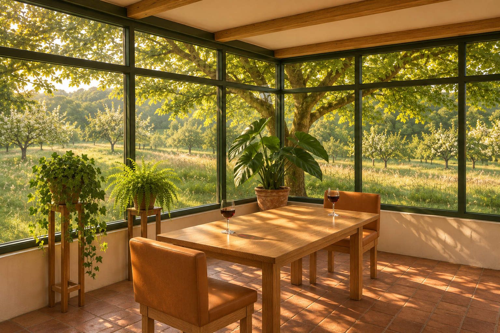
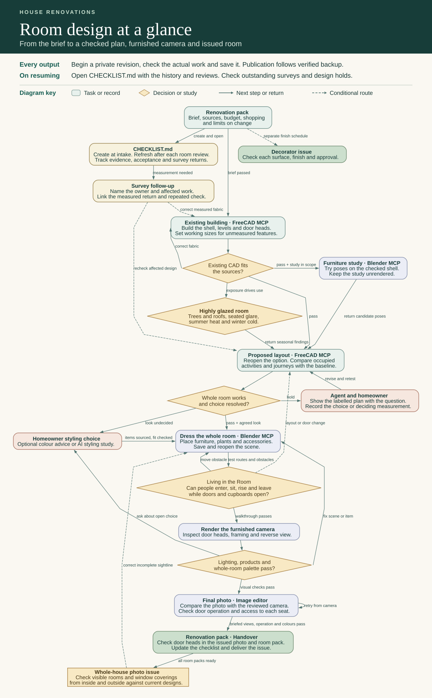

# Room by Room

Plan a renovation room by room, from the first viewing to the drawings, shopping lists and finishes you can hand to a tradesperson.

[**Visit the Orchard Fold conservatory**](https://roombyroom.pages.dev/) · [Start your own project](#start-a-project) · [Contributor guide](CONTRIBUTING.md)

[](https://roombyroom.pages.dev/)

*What would it take to eat breakfast here in January and still enjoy the orchard view in July?* At the fictional Orchard Fold, a field maple shades the reading chair late in the day, but the glass roof lets in the midday sun. Follow the household from its first question through a year of modelled temperatures to the furnished design.

**Watch the Orchard Fold walkthrough**

https://github.com/user-attachments/assets/2b56c71a-fcbd-4ecf-aa00-cb0d9256ff42

[Explore the survey, models and results](examples/conservatory/README.md) · [Browse more worked examples](examples/README.md) · [Download an Alder Cottage handover pack](examples/furnished-room/README.md#download-just-one-pack)

## Start a project

Open this repository in your agent. Give it the listing, sketch or brief you already have and tell it which decision you want help with.

> Start a house called Maple Cottage. Here’s the listing. Turn the spare room into a Vice City listening room. Keep my turntable and speakers. I’d like an editable CAD design, a furnished view and a UK shopping list. Suggest the finishes and furniture. Tell me what I should measure on the next viewing.

Or, for a change of layout:

> Start Willow Terrace. Move the kitchen into the dining room and turn the old kitchen into a utility. I want to see how meals and laundry would work, what we’d lose in storage, and whether moving the hall door would help. Show me the plans before spending time on renders.

**A useful first response from the agent** gives the homeowner a link to their house dashboard, a short reading of the brief, the rooms and adjoining spaces affected, what the agent can start now, and the first question or measurement that would change a decision. Use what the homeowner has already supplied. The intake below is a menu for the conversation.

### What to send

Send the material you already have and the decision you want to make. The [homeowner intake guide](docs/intake.md) includes a short brief you can copy, examples of permitted changes and what to gather at a viewing.

### If the starting point is Rightmove

Keep the listing and its date, map photos to the floor plan and ask for the measurement that decides the fit. [Working from a listing](docs/intake.md#if-the-starting-point-is-rightmove)

## How agents fill gaps

Keep observed fabric, household choices, proposals and unmeasured assumptions identifiable. Record what would change a decision, who can check it and which rooms depend on it. [Examples of filling a brief](docs/intake.md#how-agents-fill-gaps)

## Two ways through the same process

Follow a [listening room or kitchen swap](docs/intake.md#two-ways-through-the-same-process) from the first request. For a larger commission, use the [whole-house decision guide](skills/renovation-pack/references/whole-house.md). The [example library](examples/README.md) includes garden sun, permissions, occupied access, tender comparisons and living through the works.

## Using the toolkit on a real property

Use the plans, calculations, prices and AI images to explore options and brief your professional team. The worked examples use assumed dimensions and costs. A passed software check records what the model showed for those inputs. Before ordering, altering the building or relying on a drawing for construction, have the site dimensions, structure, services, costs and applicable permissions checked by the relevant qualified professionals and authorities. AI images can change openings, clearances and finishes. Check the measured plan and product specification before making a decision.

Keep household briefs, listing photos, floor plans, models and backups in private storage. A saved backup contains the whole house in an unencrypted ZIP. Check what an agent, cloud service or image tool will receive before sharing someone’s material. Use fictional data or material you have permission to redistribute in public issues, pull requests and examples.

## Explore the workflow

[**Specialist workflow diagrams: when each tool is triggered**](docs/specialist-workflows.md) · [Open the interactive workflow SVG](docs/workflow.svg) · [Open the shorter tool map](docs/workflow-quick.svg)

[](docs/workflow.svg)

Open either SVG directly in a browser. Select a task or diamond to see its tools, or choose **Specialist studies** for questions such as beam sizing, solar panels and overheating. **Back to map** returns to the diagram. If GitHub shows an image preview, download the SVG and open the saved file. You can also expand the guide here.

<details>
<summary>Explore the stages and tools in this README</summary>

| Where you are in the project | Tools and decisions |
| --- | --- |
| [Brief, permissions and revisions](docs/workflow-decisions.md#brief-permissions-and-revisions) | Renovation Pack and the house commands record evidence, permitted changes and homeowner decisions, then save the checked revision. |
| [Existing building and occupied layout](docs/workflow-decisions.md#existing-building-and-occupied-proposal) | FreeCAD, BIM and TechDraw model the building. IfcOpenShell reads supplied models. Blender explores furniture positions. Shapely and NetworkX check the occupied routes back in CAD. |
| [Specialist studies](skills/renovation-pack/references/specialist-design-tools.md#requests-that-trigger-a-specialist-study) | Follow a household question to its tools and return point, including QGIS and LiDAR for obstructions, Sun Position and pvlib for sunlight and solar, and EnergyPlus for indoor comfort. |
| [Structural openings](docs/workflow-decisions.md#worked-example--a-support-beam-over-the-kitchen-opening) | Section the opening in FreeCAD. For a commissioned analysis, PyNite models the beam and FreeCAD FEM runs CalculiX. Return verified support sizes to the layout, tender and works programme. |
| [Furnishing, colour and final photography](docs/workflow-decisions.md#furnishing-colour-and-final-photography) | Blender checks the furnished camera and product variants. Colour Expert supports palette decisions. Reference-image editing produces the final concept photo from the reviewed camera. |
| [Issue, costs and occupied works](docs/workflow-decisions.md#issue-shared-costs-and-later-work) | Check the decorator schedule, compare tenders and phase essential facilities using the local programme or OpenProject. Verify the room photographs and assemble the house pack. |

</details>

The diagrams include whole-house photo commands from the working toolkit. Run `python house.py --help` to see which checks this checkout provides.

## Agent operating instructions

<details>
<summary>Setup, commands and evidence for agents</summary>

Open the [house checklist](docs/house-checklist.md) at intake and on resume. Refresh it with `python house.py checklist "House"`. Before changing a drawing or pack, start a private revision with `begin-revision`. Use `save-revision` to record the checked output and verify its backup. On resume, use `history` for previous work and `status` for outstanding reviews. [Revision and recovery guide](docs/output-revisions.md)

For a question about moving through an occupied room, use the [CAD route review](skills/freecad-renovation/references/route-studies.md). Before issuing a pack, follow the [delivery workflow](docs/pack-delivery.svg) and the [drawing and photograph release guide](docs/visual-release.md).

### Verify the design tools on a new computer

Use the [tool requirements and dated readiness check](docs/tools.md) to see which tools each job needs, how to exercise them, and which specialist checks depend on a separate installation or service.

For a live design decision, use [where the specialists come in](docs/agent-workflow.md#where-the-specialists-come-in) to find the responsible skill, the evidence it returns and the room, budget or house decision to update.

The agent instructions and skills travel with Git. The native applications, MCP client configuration and Blender add-on belong to the computer running the agent. Read the repository copies of the skills even when the agent has no personal skills installed.

| Tool | How to establish readiness without rendering a house |
| --- | --- |
| Live FreeCAD MCP | Start the matching desktop add-on on localhost and register its MCP server in your agent. Query `get_rpc_status` and `list_documents`. Build a scratch feature through MCP, save, reopen, measure its actual shape and inspect a view. Check BIM availability when using BIM objects. [Connector installation and tools](https://github.com/neka-nat/freecad-mcp) |
| Live Blender MCP | Register the server and enable its matching add-on on localhost. Call `get_addon_status` and `get_scene_info` with settings. Confirm the active scene and scale, then save and reopen a scratch transfer to verify a known dimension and landmarks. [Connector setup](https://github.com/ahujasid/mcp-for-blender#quickstart) |
| Final AI image | Confirm the active agent has an image-editing tool that accepts the actual Blender camera image as an input. Keep the finish study pending if that input or capability is missing. |

On a new machine, restore the named house's private files and check the native models and textures open. Before a visual handover, match the actual input revision, CAD units, two identifiable openings and named furniture to the reviewed plan. Re-run living-use checks when a room or its adjoining route changes. The [workflow diagram](docs/agent-workflow.md) shows how MCP and deterministic scripts build the shell, explore furniture, verify the chosen layout and release each output.

Read [AGENTS.md](AGENTS.md) and the named house’s dashboard, original brief, decisions and room reviews. Run commands from the repository root. Use Python 3.11 or 3.12 for the tested workflows. The starter uses the standard library. FreeCAD, Blender and an image-generation tool are used for the corresponding design stages. The starter creates files and registers. The agent produces and reviews the designs.

```sh
python house.py list
python house.py start "Maple Cottage" --room "Listening room"
python house.py add-room "Maple Cottage" "Hall"
python house.py status "Maple Cottage"
```

If an original brief is already a local file, include `--brief-file "path/to/brief.pdf"` on the **initial** start command. The file is copied unchanged. A chat message or listing URL can be the original brief too: save the supplied wording or reference under `source/original-brief/` and register it. Add rooms as they become known. For an existing house, resume its folder and use `prepare-reviews` to add missing room registers where needed.

| Inside `houses/<house>/` | What belongs there |
| --- | --- |
| `README.md`, `brief.md`, `decisions.md` | Current dashboard, working brief, dated choices, open questions and the next useful action for a fresh chat. |
| `source/`, `sources.csv` | Original inputs and the evidence register. Give each source an ID, origin or URL, date, local path if available, reliability and decision affected. |
| `rooms/<room>/README.md`, `layout-checks.csv`, `review.csv` | Room brief and links, revision-specific design and use checks, then the status and evidence for each handover. |
| `shopping.csv`, `budget.csv` | Item identities, variants, quantities, fit and buying decisions, plus whole-project allowances, inclusions and exclusions. |
| `.revision-work/<ID>/outputs/` | Create or revise drawings, native files, images and packs in the private directory printed by `begin-revision`. |
| `revisions/<ID>/outputs/`, `revisions/<ID>/record.json` | After `save-revision` verifies the backup, link the saved output from the review. The record identifies its inputs, files and reason for change. |
| `models/`, `views/`, `handover/<issue>/` | Earlier models, images and issues can still be opened at their recorded paths. |

The entire house library is ignored by Git. Keep your private backup outside the checkout. [Recover a house from backup](docs/output-revisions.md#back-up-or-restore-one-house).

</details>

## Design and review stages

A full furnished room continues through the camera review, final concept photo and downloadable pack. Purchase-only survey holds stay attached to ordering. The next-room invitation follows the completed issue. [Room handover and shorter commissions](skills/renovation-pack/references/handover-gates.md#finishing-a-furnished-room)

When a choice is easier to see, the agent shows a labelled plan, photo or comparison beside the question. The saved revision carries that exact image and its description so you can return to it later. [How visual questions are checked](docs/output-revisions.md#record-the-next-homeowner-choice)

When you review a result, the agent asks what works for you and what you would change. It can suggest a detail or two from the work to help you get started. You can raise something else, move on to another part of the house or pause. If a decision is holding up the work, the agent asks about it directly and explains what your answer changes. A returning agent can pick up from your reply. [How the handover is saved](docs/output-revisions.md#record-the-next-homeowner-choice)

Every house uses the same ordered room register. A listing-only buyer study or a CAD-only request can finish at its agreed deliverable. Leave later stages pending or explicitly held. A full pack continues through all seven.

| Stage in `review.csv` | Evidence to inspect before recording a pass |
| --- | --- |
| `brief` | Original request reconciled with later decisions. Identify the room, adjoining spaces, activities, retained items, house limits, room exceptions, delegated choices, requested outputs and open questions. |
| `existing-cad` | An editable existing FreeCAD model, dimensioned plan and useful section or 3D cutaway. Compare source photographs with walls, openings, levels, hearths, radiators and services. Label provisional geometry. |
| `proposed-cad` | A separate editable proposal and an existing/proposed comparison. Record **intent** (the preferred relationship), **use** (an activity with furniture or equipment occupied or open), and **journey** (the whole route through the real threshold). Check seated views, reach, storage and simultaneous uses where relevant. Show the limiting dimension and unresolved compromises. Record a fourth check, **whole-room**, against one CAD plan showing how the activities and journey work together. Older rooms need this evidence before their next proposed-layout release. |
| `blender` | Transfer the reviewed CAD revision and check a known dimension, orientation, openings and the named cameras. Furnish from the schedule. Inspect a reverse view where the main camera hides a critical feature. |
| `products` | Match visible scene objects to item IDs, selected variants, sizes, quantities and product references. Record reconstructed pieces, allowances, shared items and anything out of frame. |
| `final-ai` | Generate each final image directly from its reviewed furnished Blender camera. Compare it with that camera and the product references for altered doors, glazing, furniture identity, room geometry and clear routes. Hold misleading studies and correct the earliest stage where the error appeared. |
| `handover` | Reopen native files, check the drawing and image revisions, inspect the presentation and verify the delivered archive. Include remaining decisions, site measurements and professional work. |

Record `pending`, `hold` or `pass` for each stage. A pass requires a revision, reviewer, finding and inspectable house-relative evidence. For new design handovers after the brief, link the checked file under `revisions/<ID>/outputs/`. In the layout register, give each check a source, expectation, observation and result. Inspect the actual output. For detailed criteria use the [room and sightline checks](skills/renovation-pack/references/layout-review.md) and [handover checks](skills/renovation-pack/references/handover-gates.md).

```sh
python house.py prepare-reviews "Maple Cottage"
python house.py check-study "Maple Cottage" "Listening room" --input-revision R3
python house.py check-layout "Maple Cottage" "Listening room" --input-revision R3
python house.py check-render "Maple Cottage" "Listening room" blender --input-revision R3
python house.py check-render "Maple Cottage" "Listening room" final-ai --input-revision R3
```

These check commands report the first unresolved prerequisite and exit unsuccessfully on a hold. Supply the actual document or camera revision with `--input-revision`. The study check covers the existing shell for an in-scope unrendered exercise. The proposed layout, furnished camera and AI image have their own checks. The commands do not generate images or release an explicit homeowner hold. Use the [renovation-pack](skills/renovation-pack/SKILL.md), [FreeCAD](skills/freecad-renovation/SKILL.md) and [Blender](skills/blender-interiors/SKILL.md) instructions for production.

For a conservatory or another highly glazed room, the first room review includes seasonal use, external shadows, glare from the intended position, overheating and winter comfort. Record the four current findings before furnishing. [Glazed-room review and evidence](skills/renovation-pack/references/glazed-rooms.md)

## Shopping, costs and the finished pack

Before the final AI photo, the agent reviews the colours together in every furnished room. If two finishes clash or a piece disappears against the wall, the agent shows you where and suggests the smallest adjustment. Your brief sets the standard, including when you want a bold contrast or a quiet, tonal room. You can choose the scheme or delegate it. The agent can consult meodai’s optional `color-expert` adviser for an open choice.

Final image review checks for colour drift against the furnished Blender camera. When issuing finishes to a decorator, run `python house.py check-decorator "House" "Room" --input-revision R3` on the actual schedule revision. A shade awaiting a physical sample can still appear in the concept. [Colour decisions, installation and decorator handover](skills/renovation-pack/references/colour-decisions.md)

Once the layout and look are chosen, furnish the full room in Blender. Reconcile the item schedule with the scene and record which camera shows each piece. Use a styling concept only when it would help decide the look. Only the reviewed furnished camera supplies the geometry for the final AI photo.

Start the shopping schedule during briefing so furniture sizes influence the CAD. Give every piece an ID and a decision such as reuse, shortlist, buy, optional, omit or quote. For a selected product record the exact variant, finish, quantity, dimensions, supplier link, unit price and date checked, fit dependencies, reference image and Blender object. For a reused piece, obtain its actual dimensions. Check delivery access and lead time where they affect the choice. Keep estimated costs distinct from dated prices and quotes. Reconcile quantities and shared items before totalling the budget. Before final AI, record a same-camera lighting test and neutral product-finish comparisons in the room’s `finish-checks.csv`. See the [Blender lighting and finish review](skills/blender-interiors/references/lighting-and-finishes.md). An item can appear in a concept while its purchase remains on hold.

| Recipient | What a full issue should let them do |
| --- | --- |
| Homeowner | Walk through the house as they would use it. Open the presentation and room book, compare existing and proposed plans, inspect furnished and final images, choose finishes and see what to buy, when and at what estimated cost. |
| Buyer | Decide what to investigate before purchase. See feasibility, cost ranges, disruption, assumptions and a prioritised viewing or survey checklist. |
| Architect | Take up the design intent with editable existing and proposed CAD, room and product schedules, plans, relevant sections and elevations, changes to openings or services, evidence and unresolved technical questions. Survey-dependent details stay identified for professional development. |

For the full issue checklist, use [deliverables by audience](skills/renovation-pack/references/deliverables.md). End each working session by updating the named house’s dashboard with its latest reviewed revision, the next action, any decision for the homeowner and the outputs currently on hold. A new chat can then start with “Open House Renovations and resume Maple Cottage.”

## Licence

The original code, agent skills, documentation, templates and original example assets are available under the [MIT licence](LICENSE). Keep its copyright and permission notice with copies or substantial portions. The licence includes the warranty disclaimer and limitation of liability. External software, services, trademarks and material supplied for a house retain their respective terms. Check the rights to photographs, listing plans, product imagery and other third-party assets before redistributing them.

The combined PDF tools use the GNU Affero General Public License version 3 (AGPLv3). The public release supplies the toolkit source and fictional recipient files. The Python installer fetches the PDF engine separately. See the [distribution terms and pinned dependency sources](THIRD-PARTY.md#pdf-tools) and the [AGPLv3 licence](LICENSES/AGPL-3.0.txt).
