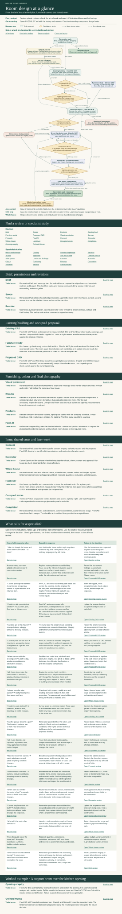

# How a house moves from brief to handover

At handover, follow the separate [pack delivery diagram](pack-delivery.svg) for a standalone room review, checked drawing or shopping schedule and for assembling them into a house issue.

At intake the starter creates [the live house checklist](house-checklist.md). Each room review updates its linked evidence. A returned survey goes back through the affected checks before it closes. Read the checklist beside either workflow diagram on resuming.

When resuming, read the house history, dashboard and room reviews together. For each output, use `begin-revision`, work in the printed private directory and inspect the result. `save-revision` verifies a private whole-house backup before publishing the revision. Link the checked file under `revisions/<ID>/outputs/` from the review. [Saving revisions and restoring private files](output-revisions.md)

The renovation-pack skill owns the brief, decisions and issue. It hands measured building geometry and occupied layouts to the FreeCAD skill. Blender can try furniture positions on a checked shell and returns them to FreeCAD for the fit decision. After layout approval, Blender dresses the full room and reopens the scene. [Living in the Room](../skills/living-in-the-room/SKILL.md) checks occupied routes, seat access and opening movements before the furnished camera is rendered. The final photo is compared with that camera. Both modelling skills inspect the reopened native document through MCP. [Renovation pack](../skills/renovation-pack/SKILL.md) · [FreeCAD renovation](../skills/freecad-renovation/SKILL.md) · [Blender interiors](../skills/blender-interiors/SKILL.md)

[Full workflow diagram](workflow.svg) · [Quick reference](workflow-quick.svg) · [Text of the gates, questions and return paths](workflow-decisions.md)



The full diagram starts with the room workflow above, then shows when each review can proceed, who resolves a hold, the specialist triggers and the support-beam example. Both diagrams share the same room map. [Editable room map](workflow.dot) · [Diagram renderer](render_workflow.py)

At handover the agent reads the brief, latest instructions and checked result to [choose and word the follow-up](../skills/renovation-pack/references/homeowner-decisions.md#at-the-end-of-a-commission). It invites feedback on a review, asks directly about a blocking preference, or continues work already chosen. Technical unknowns go to their evidence owner. The agent supplies the wording to `house.py`, which validates any required image, saves the prompt and can replay it alongside the recorded next action. [Record and resume a choice](output-revisions.md#record-the-next-homeowner-choice)

When a spatial preference is needed during a study or at handover, show a labelled, checked plan or image in chat before asking. Match the wording to the activity and features visible in that revision. [Visual questions](../skills/renovation-pack/references/homeowner-decisions.md#show-the-choice)

Taking up a conservatory triggers [the glazed-room review](../skills/renovation-pack/references/glazed-rooms.md) on the first request. For another highly glazed room, register the exposure from its brief and photos. The proposed CAD gate checks all four findings with the occupied room.

## Where the specialists come in

Choose a study when its answer could change the next decision. Record the result, assumptions and affected revision with the person who will use it. The three repository skills own the handovers below. They use the tools named in their row when the brief and evidence call for them.

Screen each new request and each return from another room, surveyor or supplier. An owner who asks to “open up the kitchen” has raised a structural question even if they never mention a beam. Route the question when it affects a decision, then bring the answer back to the same review. [Requests that trigger specialist work](../skills/renovation-pack/references/specialist-design-tools.md#requests-that-trigger-a-specialist-study) · [Support-beam example and occupied layout loop](workflow-decisions.md#worked-example--a-support-beam-over-the-kitchen-opening)

| When the question arises | Who does the work | What comes back, and where it goes |
| --- | --- | --- |
| At intake, could a survey, consent or decision about living through the works change several rooms? | Renovation-pack coordinates the property evidence, homeowner decision and enquiries for the relevant UK nation. | The house dashboard names the deciding unknown, who can resolve it and which rooms, orders or prices depend on it. A buyer can finish here with a prioritised survey brief. [Whole-house decisions](../skills/renovation-pack/references/whole-house.md) · [Consent enquiries](../skills/renovation-pack/references/uk-consents.md) |
| Would a new opening, support, drain or extract route change the fit? | FreeCAD overlays the affected storeys and sections. A surveyor, engineer or installer supplies the deciding measurement or design. PyNite or FreeCAD FEM with CalculiX can support a commissioned analysis. | Put the returned footprint, headroom, fall or outlet position into the occupied plan. Recheck dependent rooms, orders and tenders. [Structural and services studies](../skills/renovation-pack/references/specialist-design-tools.md#fabric-and-feasibility) · [Occupied pier replay](../examples/whole-house-changes/README.md) |
| Would a seat, door or table move improve the household’s routine? | FreeCAD checks the occupied geometry. Shapely and NetworkX measure connected routes. If authorised, Blender explores placements and views on the checked shell. | Return the candidate’s positions, fronts and units to FreeCAD. Review every intended position with the shared route on one plan. A CAD-only brief can finish with the checked drawing or measured reason an option is held. [Route studies](../skills/freecad-renovation/references/route-studies.md) · [Furniture studies](../skills/blender-interiors/SKILL.md#explore-furniture-before-a-layout-is-selected) |
| Would shade, overheating or rooftop solar change a seat, window or roof decision? | Renovation-pack selects the comparison. QGIS can establish terrain and obstructions, Blender Sun Position or pvlib can compare sunlight, and EnergyPlus can compare indoor conditions when the building inputs support it. | Return the timed shadow, comfort comparison or PV yield and assumptions to the relevant site, glazing or roof option. Identify the measurement that could reverse it. [Sun and comfort](../skills/renovation-pack/references/specialist-design-tools.md#sun-and-comfort) · [Rooftop solar](../skills/renovation-pack/references/specialist-design-tools.md#rooftop-solar) |
| Is the palette undecided, or does a specified finish look wrong? | Blender checks the actual furnished camera, lighting and product variants. The optional `color-expert` skill advises on a choice or colour cast. The homeowner decides consequential changes or delegates them. | Record the room palette before final AI. The image editor takes the reviewed camera and product references. Compare each result with that camera. For a separate decorator issue, check the surface schedule and physical approvals. [Colour and decorator checks](../skills/renovation-pack/references/colour-decisions.md) |
| Can the household afford the change and stay while it is built? | Renovation-pack compares tenders on the same scope and sequences access, services and temporary facilities. Use a phase table or OpenProject when a programme is commissioned. | Return comparable costs, the affected nights or services, and the household’s next choice to the budget and dashboard before dependent orders. [Worked tender and occupation example](../examples/whole-house-changes/README.md) |

## When to move on

After a furnished camera passes, `house.py next` identifies unfinished photo or pack work before the agent invites a change of room. A purchase-only hold preserves the survey action while allowing a checked visual concept to proceed. A completed room pack contains the reviewed final photo. [Scope, evidence and exceptions](../skills/renovation-pack/references/handover-gates.md#finishing-a-furnished-room)

For operable fittings, the proposed CAD and furnished camera gates use [the opening clearance study](../skills/freecad-renovation/references/opening-clearances.md). Check the prepared native scene before rendering. Reconcile visible projections across models and show a failed interface as a diagnostic.

For a whole house, the dashboard ties these room stages to the owner decision, survey, consent or price that affects several rooms. Use the [whole-house workflow](../skills/renovation-pack/references/whole-house.md) and the [occupied works example](../examples/whole-house-changes/README.md). A shared technical finding can inform a room while its layout review remains open.

At steps 2 and 4, assess the routine on the existing plan and rerun the affected journeys for a moved piece or authorised renovation. Shapely checks occupied plan geometry and NetworkX connects usable passages. The current-revision journey evidence feeds the existing layout gate. Baseline findings can be issued for a buyer even when a proposed fit would require more evidence. [Route inputs, assumptions and outputs](../skills/freecad-renovation/references/route-studies.md)

| Step and owner | Work and evidence | Condition for advancing |
| --- | --- | --- |
| 1. Intake · renovation-pack | Open or create the house. Preserve the original email, listing, plans and photos. Record who uses each room, what stays, the scope of permitted changes and which decisions belong to the homeowner. Start the shopping and cost schedules. | Pass the room’s `brief` review when the intended activities, relevant sources and limits are understood well enough for this study. Ask only about gaps that change the next decision. |
| 2. Existing building · FreeCAD MCP | Establish axes, levels and scale against the best available evidence. Set editable working dimensions for consequential unknowns in the [CAD assumptions register](../templates/house/cad-assumptions.csv), record their basis and survey owner, and test the range that could change the design. Build the surveyed or traced shell, including openings, stairs, services and fixed obstructions. Script repeated components with named dimensions. Save the native baseline, reopen it and compare plan and section with the sources. | Pass `existing-cad` for the intended decision. Label provisional dimensions. Where an unknown can reverse a fit decision, request the measurement and keep that fit open. |
| 3. Explore options · FreeCAD and optional Blender MCP | Use separate FreeCAD documents for permitted building changes. For an in-scope furniture study, check the shell with `check-study`, transfer it at known scale and lock it in an unrendered Blender working scene. Try different arrangements from the door and at seated eye height. Return promising placements to FreeCAD with item IDs, world coordinates, units and functional fronts. | A candidate can enter proposed CAD. A viewport study carries no layout, product or render approval. A CAD-only request stays in FreeCAD. A hold on all visual work also pauses the viewport study. |
| 4. Test real use · FreeCAD MCP and deterministic checks | Save and reopen each proposal. Measure the actual geometry and operated or occupied envelopes. Overlay access, task, travel and any requested views on one legible plan. Inspect the plan and cutaway. Compare permitted options against the same routine. | Pass `proposed-cad` and `check-layout` at the current revision. If it fails, change a permitted arrangement and retest. Ask the homeowner when the remedy would cross a boundary or requires a consequential choice. Record selection before furnishing. |
| 5. Furnish and review · Blender MCP | Check render permission, import the selected CAD revision, verify scale, two identifiable features and direction. Populate the scene from the shopping schedule. Check world transforms, visible product details, count, clearances and camera framing. Review the saved camera and reverse view. Record the lighting comparison, neutral product finishes and whole-room palette in `finish-checks.csv`. | Pass `blender` for the camera and `products` for the scheduled variants and room palette. A proxy may answer a fit question. Obtain product evidence before using it for visual identification. A render hold pauses the render. |
| 6. Final photo · image tool and renovation-pack | Use the reviewed, fully furnished Blender camera as the image input. Supply the selected product references. Compare the result side by side for openings, furniture identity, geometry, light and circulation. | Pass `final-ai` for the particular camera. Regenerate a finish error from the reviewed camera. Correct a misplaced object in Blender or a faulty opening in CAD and recheck downstream work. |
| 7. Issue · renovation-pack | Reopen the native documents, inspect the actual exported drawings and image pairs, reconcile shopping quantities and costs, extract the handover archive and check it against the agreed scope. | Pass `handover` for the issue. Deliver the homeowner presentation and shopping list, buyer checks and architect brief/drawings for the commissioned scope. Record what still needs a survey or professional design. |

For a buyer’s assessment, issue the finding and next viewing or survey check as soon as the evidence supports them. For CAD-only work, issue the checked plan or diagnostic comparison at step 4. Label any held option with its measured failure. Leave uncommissioned visual stages pending or held in the room register. The full visual pack continues through the camera, product, AI and handover reviews.

## How much to dress

At stage 5 inspect every furnished room as a whole against the brief and record a current `room-palette` finding. Name the light, locate any concern and suggest the smallest useful adjustment. An optional suggestion can accompany a pass. For a consequential open choice, ask the homeowner or follow their delegated authority. The optional `color-expert` adviser can help with the judgement. Compare each generated final image with its reviewed camera in an `ai-colour` check. A decorator issue has its own surface schedule and sample approval. [Decision rules and evidence](../skills/renovation-pack/references/colour-decisions.md)

Use dimensioned proxies to answer the layout question. Once layout and look are settled, dress the whole room in Blender. Reconcile every selected or reused shopping item and its quantity to the actual scene. Spend modelling detail on identifiable products and pieces that change use. Use simple reusable assets for incidental styling. If the look is undecided, an optional styling concept can precede sourcing. The final AI photo starts from the reviewed furnished camera. Compare the resulting photo with that exact camera and product references. Adopted design changes go back through the schedule, scene and affected CAD checks.

## What the agent runs

Check the [tool requirements and verified environments](tools.md) before assuming a desktop add-on, optional solver or hosted service is available. For an example of a house decision crossing several room stages, follow the [returned pier through tenders and occupation](../examples/whole-house-changes/README.md).

The [worked examples](../examples/README.md) pair a brief with the tool calls, evidence and decision at the handover. Start there to replay a numerical check or inspect a recorded room review.

- **Live modelling.** Inspect the connection and actual file before each mutation. Call native MCP tools for small changes. For a repeatable build, run reviewed, parameterised code through the connector in the selected scratch or option document. FreeCAD exposes `execute_code`; Blender exposes `execute_blender_code`. Use the installed connector’s accepted operations. In Blender safe mode the client can send the reviewed function definitions directly. Keep the connector’s settings intact.
- **Building geometry.** Derive level, wall, slab, stair and opening dimensions from the house’s own sources. Preserve source IDs and uncertainty with the inputs. A script can produce an entire storey or shell. The [editable wall and opening helper](../skills/freecad-renovation/scripts/wall_openings.py) builds native features and measures occupied solid intervals at a supplied height.
- **Furniture and native evidence.** Save each candidate in a new revision. Reopen the named file and ask the application for actual geometry. Read the functional front from identifiable features. The [Blender mesh check](../skills/blender-interiors/scripts/layout_readback.py) measures seat, back and target meshes in world space, including parent rotation and scene units. Use individual object features or fitted markers with recorded evidence when a product is a single mesh.
- **Independent calculations.** Run pure calculations or drawing exports locally against the geometry read back from the saved revision. Route widths, sightlines, radial spacing and costing are reproducible here. Record assumptions, tolerances and units. Check the exported sheet visually. The [pier replay](../examples/whole-house-changes/README.md) compares the straight gap with the continuous occupied route.
- **Workbook and evidence.** `house.py` creates projects and checks their records. Put source, revision, reviewer, finding and evidence in the room registers. For native work record the connector, native filename, revision, checked object IDs and observed values in the linked evidence. Use the actual file’s revision on the commands below. A passing command checks the recorded prerequisites. The reviewer still inspects the design and honours the latest instructions.

```sh
python house.py check-study "House" "Room" --input-revision R3
python house.py check-layout "House" "Room" --input-revision R3
python house.py check-render "House" "Room" blender --input-revision R3
python house.py check-render "House" "Room" final-ai --input-revision R3
```

Run the applicable command at its handover. If a connector is unavailable, reconnect to the correct native application and verify the document. Continue independent brief, shopping, evidence or calculation work while it is unavailable. Keep the native handover pending. If a measurement, revision or homeowner decision changes, reopen the affected room, shared thresholds, products and downstream cameras.

## A building operation through MCP

For a straight hall wall, choose the reference corner and orientation from the source plan. Create a named option document with FreeCAD MCP. Load the wall helper into that session and call the functions with the document explicitly selected. For example, these inputs describe a 5 m wall at 30° with a door and a window.

```python
origin = (100, 200, 250)
build_wall(doc, "HallWall", origin, 30, 5000, 180, 2700,
           openings=[(650, 800, 0, 2050), (3000, 1050, 900, 1000)])
```

Save to a new native file. Call `reload_document` on that file's document name and reacquire `doc` from the reopened document. At 450 mm above the wall base, `solid_spans(doc.HallWall, origin, 30, 5000, 180, 450)` should return solid intervals of 0–650 and 1,450–5,000 mm. Repeat above the sill to verify the window. An authorised alternative with the door moved should change those intervals while the retained window and overall wall dimensions stay consistent. The architect can edit the native box and cut features.

## What was exercised in the migration

The scratch connector rehearsal uses a rotated wall and opening. Reopen the saved model and compare its measured opening interval with the declared dimensions before using the connector on a house.

The [lounge case study](../examples/lounge-door.md) follows the door and furniture decisions through visual review.

## Room photos and the final house issue

Brief the room view and the design in operation, review the final photographs against their cameras, then reconcile each visible adjoining room against its current issued view at house assembly. Check the outside face of each visible window treatment in room, facade and reflected views against its owning room. Use the [photo evidence and whole-house commands](../skills/renovation-pack/references/photo-quality.md).

[Valuation tool-call diagram](valuation.svg) · [Property brief, comparable research and index reconciliation](../skills/renovation-pack/references/valuation.md).

A door first passes its [elevation and travel checks](../skills/freecad-renovation/references/opening-clearances.md#check-the-doorway-in-elevation) in CAD. Repeat the elevation in the furnished scene before a concept or final camera, including doors in adjoining rooms. Inspect the actual head in the issued image and carry the result to pack selection.
