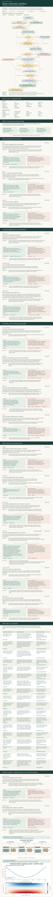

# How a house moves from brief to handover

Start each new output in a private revision workspace. Save its inputs, outputs and change record before linking to it at review. A returning agent reads the house history alongside the dashboard. [Saving revisions and restoring private files](output-revisions.md)

The **renovation-pack skill** follows the homeowner’s brief, keeps the records and decides which tool to call. The **FreeCAD skill** owns measured building geometry, openings, options and the coordinated plan. The **Blender skill** explores what it feels like to use the room and later produces the furnished camera. Both skills work on the live native document over MCP. Scripts build repeatable geometry and measure what was actually saved.



[Open the diagram at full size](workflow.svg) · [Editable diagram source](workflow.dot)

## When to move on

For a whole house, the dashboard ties these room stages to the owner decision, survey, consent or price that affects several rooms. Use the [whole-house workflow](../skills/renovation-pack/references/whole-house.md) and [worked kitchen example](../examples/whole-house-changes/README.md). A shared technical finding can inform a room while its layout review remains open.

At steps 2 and 4, assess the routine on the existing plan and rerun the affected journeys for a moved piece or authorised renovation. Shapely checks occupied plan geometry and NetworkX connects usable passages. The current-revision journey evidence feeds the existing layout gate. Baseline findings can be issued for a buyer even when a proposed fit would require more evidence. [Route inputs, assumptions and outputs](../skills/freecad-renovation/references/route-studies.md)

| Step and owner | Work and evidence | Condition for advancing |
| --- | --- | --- |
| 1. Intake · renovation-pack | Open or create the house. Preserve the original email, listing, plans and photos. Record who uses each room, what stays, the scope of permitted changes and which decisions belong to the homeowner. Start the shopping and cost schedules. | Pass the room’s `brief` review when the intended activities, relevant sources and limits are understood well enough for this study. Ask only about gaps that change the next decision. |
| 2. Existing building · FreeCAD MCP | Establish axes, levels and scale against the best available evidence. Build the surveyed or traced shell, including openings, stairs, services and fixed obstructions. Script repeated components with named dimensions. Save the native baseline, reopen it and compare plan and section with the sources. | Pass `existing-cad` for the intended decision. Label provisional dimensions. Where an unknown can reverse a fit decision, request the measurement and keep that fit open. |
| 3. Explore options · FreeCAD and optional Blender MCP | Use separate FreeCAD documents for permitted building changes. For an in-scope furniture study, check the shell with `check-study`, transfer it at known scale and lock it in an unrendered Blender working scene. Try different arrangements from the door and at seated eye height. Return promising placements to FreeCAD with item IDs, world coordinates, units and functional fronts. | A candidate can enter proposed CAD. A viewport study carries no layout, product or render approval. A CAD-only request stays in FreeCAD. A hold on all visual work also pauses the viewport study. |
| 4. Test real use · FreeCAD MCP and deterministic checks | Save and reopen each proposal. Measure the actual geometry and operated or occupied envelopes. Overlay access, task, travel and any requested views on one legible plan. Inspect the plan and cutaway. Compare permitted options against the same routine. | Pass `proposed-cad` and `check-layout` at the current revision. If it fails, change a permitted arrangement and retest. Ask the homeowner when the remedy would cross a boundary or requires a consequential choice. Record selection before furnishing. |
| 5. Furnish and review · Blender MCP | Check render permission, import the selected CAD revision, verify scale, two identifiable features and direction. Populate the scene from the shopping schedule. Check world transforms, visible product details, count, clearances and camera framing. Review the saved camera and reverse view. Record the lighting comparison, neutral product finishes and whole-room palette in `finish-checks.csv`. | Pass `blender` for the camera and `products` for the scheduled variants and room palette. A proxy may answer a fit question. Obtain product evidence before using it for visual identification. A render hold pauses the render. |
| 6. Final photo · image tool and renovation-pack | Use the reviewed, fully furnished Blender camera as the image input. Supply the selected product references. Compare the result side by side for openings, furniture identity, geometry, light and circulation. | Pass `final-ai` for the particular camera. Regenerate a finish error from the reviewed camera. Correct a misplaced object in Blender or a faulty opening in CAD and recheck downstream work. |
| 7. Issue · renovation-pack | Reopen the native documents, inspect the actual exported drawings and image pairs, reconcile shopping quantities and costs, extract the handover archive and check it against the agreed scope. | Pass `handover` for the issue. Deliver the homeowner presentation and shopping list, buyer checks and architect brief/drawings for the commissioned scope. Record what still needs a survey or professional design. |

For a CAD-only commission the homeowner can receive a checked plan or diagnostic comparison at step 4. A held option can be shown with its measured failure. The stage sequence applies to the outputs actually commissioned.

## How much to dress

At stage 5 inspect every furnished room as a whole against the brief and record a current `room-palette` finding. Name the light, locate any concern and suggest the smallest useful adjustment. An optional suggestion can accompany a pass. For a consequential open choice, ask the homeowner or follow their delegated authority. The optional `color-expert` adviser can help with the judgement. Compare each generated final image with its reviewed camera in an `ai-colour` check. A decorator issue has its own surface schedule and sample approval. [Decision rules and evidence](../skills/renovation-pack/references/colour-decisions.md)

Use dimensioned proxies to answer the layout question. Once layout and look are settled, dress the whole room in Blender. Reconcile every selected or reused shopping item and its quantity to the actual scene. Spend modelling detail on identifiable products and pieces that change use. Use simple reusable assets for incidental styling. If the look is undecided, an optional styling concept can precede sourcing. The final AI photo starts from the reviewed furnished camera. Compare the resulting photo with that exact camera and product references. Adopted design changes go back through the schedule, scene and affected CAD checks.

## What the agent runs

Check the [tool requirements and verified environments](tools.md) before assuming a desktop add-on, optional solver or hosted service is available. For an example of a house decision crossing several room stages, follow the [returned pier through tenders and occupation](../examples/whole-house-changes/README.md).

The [worked examples](../examples/README.md) pair a brief with the tool calls, evidence and decision at the handover. Start there to replay a numerical check or inspect a recorded room review.

- **Live modelling.** Inspect the connection and actual file before each mutation. Call native MCP tools for small changes. For a repeatable build, run reviewed, parameterised code through the connector in the selected scratch or option document. FreeCAD exposes `execute_code`; Blender exposes `execute_blender_code`. Use the installed connector’s accepted operations. In Blender safe mode the client can send the reviewed function definitions directly. Keep the connector’s settings intact.
- **Building geometry.** Derive level, wall, slab, stair and opening dimensions from the house’s own sources. Preserve source IDs and uncertainty with the inputs. A script can produce an entire storey or shell. The [editable wall and opening helper](../skills/freecad-renovation/scripts/wall_openings.py) builds native features and measures occupied solid intervals at a supplied height.
- **Furniture and native evidence.** Save each candidate in a new revision. Reopen the named file and ask the application for actual geometry. Read the functional front from identifiable features. The [Blender mesh check](../skills/blender-interiors/scripts/layout_readback.py) measures seat, back and target meshes in world space, including parent rotation and scene units. Use individual object features or fitted markers with recorded evidence when a product is a single mesh.
- **Independent calculations.** Run pure calculations or drawing exports locally against the geometry read back from the saved revision. Route widths, sightlines, radial spacing and costing are reproducible here. Record assumptions, tolerances and units. Check the exported sheet visually.
- **Workbook and evidence.** `house.py` creates projects and checks their records. Put source, revision, reviewer, finding and evidence in the room registers. For native work record the connector, native filename, revision, checked object IDs and observed values in the linked evidence. Use the actual file’s revision on the commands below. A passing command checks the recorded prerequisites. The reviewer still inspects the design and honours the latest instructions.

```sh
python house.py check-study "House" "Room" --input-revision R3
python house.py check-layout "House" "Room" --input-revision R3
python house.py check-render "House" "Room" blender --input-revision R3
python house.py check-render "House" "Room" final-ai --input-revision R3
```

Run the applicable command at its handover. If a connector is unavailable, reconnect to the correct native application and verify the document. Continue independent brief, shopping, evidence or calculation work while it is unavailable. Keep the native handover pending. If a measurement, revision or homeowner decision changes, reopen the affected room, shared thresholds, products and downstream cameras.

## A building operation through MCP

For a straight hall wall, choose the reference corner and orientation from the source plan. Create a named option document with FreeCAD MCP. Load the wall helper into that session and call the functions with the document explicitly selected. For example, these inputs describe a 5 m wall at 30° with a door and a window.

```python
origin = (100, 200, 250)
build_wall(doc, "HallWall", origin, 30, 5000, 180, 2700,
           openings=[(650, 800, 0, 2050), (3000, 1050, 900, 1000)])
```

Save to a new native file. Call `reload_document` on that file's document name and reacquire `doc` from the reopened document. At 450 mm above the wall base, `solid_spans(doc.HallWall, origin, 30, 5000, 180, 450)` should return solid intervals of 0–650 and 1,450–5,000 mm. Repeat above the sill to verify the window. An authorised alternative with the door moved should change those intervals while the retained window and overall wall dimensions stay consistent. The architect can edit the native box and cut features.
