# Specialist workflow diagrams

Start with the change that prompted the question. Follow the arrows to see which evidence or tool enters the study and which decision to revisit. A single change can trigger several studies.

Run the study when its answer could change the design. If a deciding measurement, permission or specialist input is missing, record its owner and return to the affected review when it arrives.

## Choose a study

**Building and site**

[Structural openings](#structural-openings) · [Services](#services) · [Levels and drainage](#levels-and-drainage) · [Consent](#consent)

**Sun, glazing and energy**

[Glazing](#glazing) · [Sun and shade](#sun-and-shade) · [Thermal comfort](#thermal-comfort) · [Solar panels](#solar-panels)

**People, rooms and finishes**

[House walkthrough](#house-walkthrough) · [Access](#access) · [Sightlines](#sightlines) · [Acoustics](#acoustics) · [Colour](#colour) · [Furnishing](#furnishing) · [Finishes](#finishes)

**Buying and building**

[Valuation](#valuation) · [Tenders](#tenders) · [Occupation](#occupation) · [Survey returns](#survey-returns)

## Structural openings

“Can we open up the kitchen?” A wall moves, an opening widens or a post appears on a returned plan.

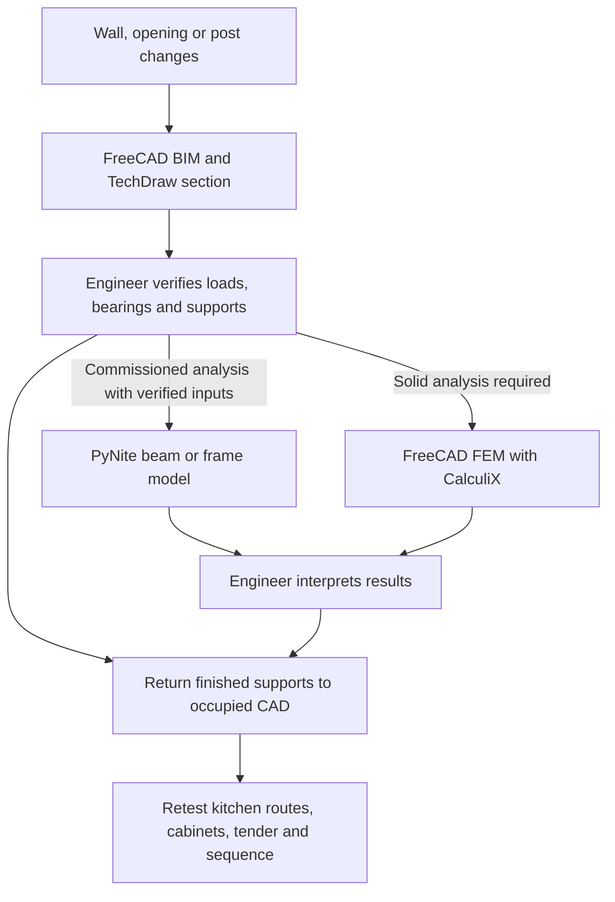

FreeCAD and TechDraw overlay both floors and section the opening. Ask the engineer for the load path, finished supports and head height. PyNite or FEM with CalculiX can support a commissioned analysis with verified inputs.

Insert the support, rerun occupied layouts, check cabinet set-out, tender scope and sequence.

[Open the worked two-solver beam example](../examples/structural-opening/README.md)

[Back to study list](#choose-a-study)

## Services

“Could the sink go under that window?” A duct, drain, joist, floor level or fitting moves.

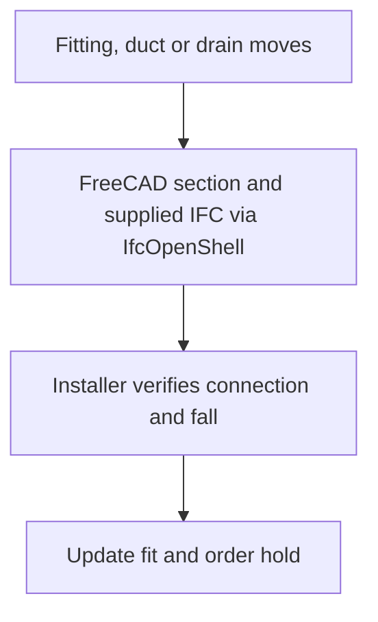

FreeCAD sections compare falls, penetrations, outlet positions and service access. An installer or surveyor verifies the concealed connection. Inspect supplied IFC units and placement with IfcOpenShell where relevant.

Update the service drawing, occupied fit and purchase or trade hold.

[Back to study list](#choose-a-study)

## Levels and drainage

“Could this patio be level?” A threshold, external level, boundary or outfall changes.

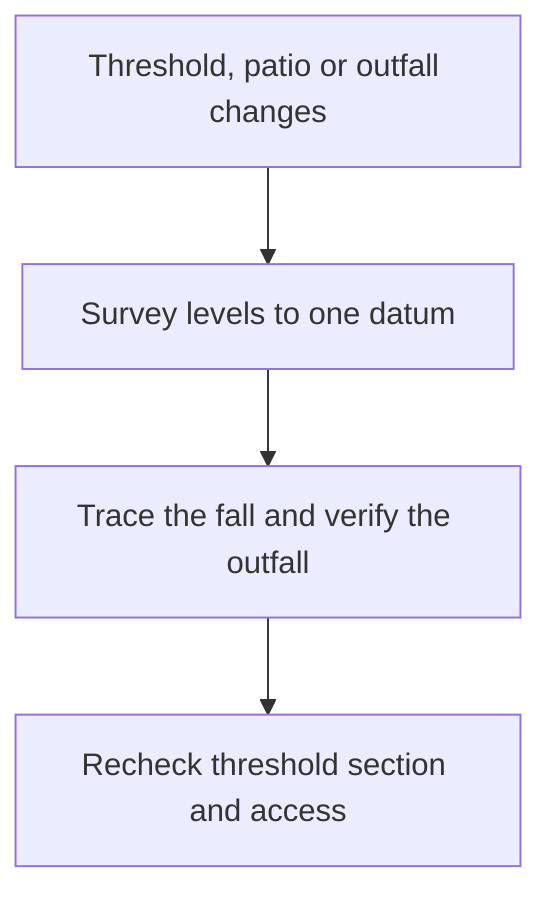

Survey levels to a common datum. Trace water to an evidenced outfall and check access. Match any map, aerial view or terrain data to the actual plot.

Recheck the threshold section, garden route and drainage enquiry before pricing.

[Back to study list](#choose-a-study)

## Consent

“Can the garage become a gym?” The footprint, frontage, use or work near a boundary changes.

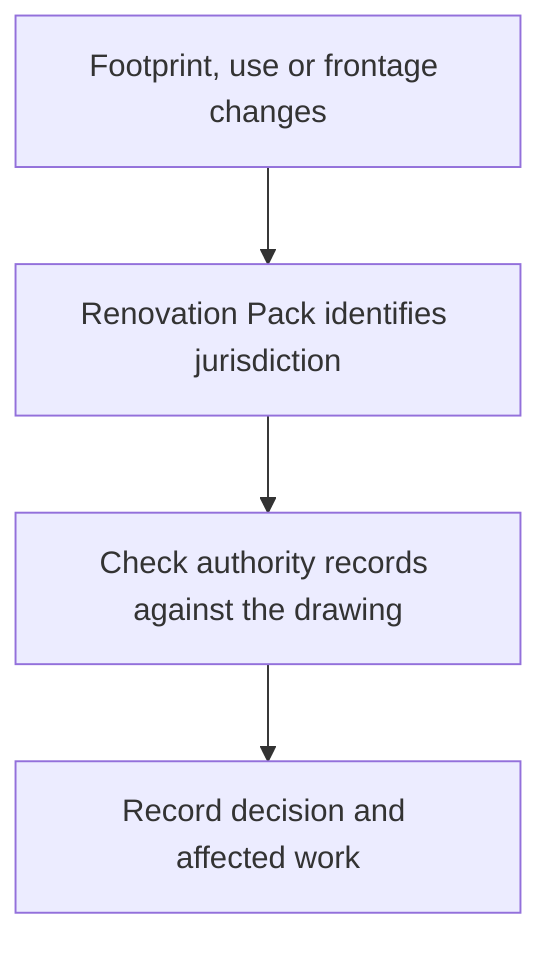

Renovation-pack identifies the nation and authority. Check plot, past decisions, conditions, other rights and the technical building-control enquiry against the proposed drawing.

Record dated evidence, who must reply and what survey, design, spend or order depends on it.

[Back to study list](#choose-a-study)

## Glazing

A conservatory, sunroom, glazed extension or roof-lit room enters review.

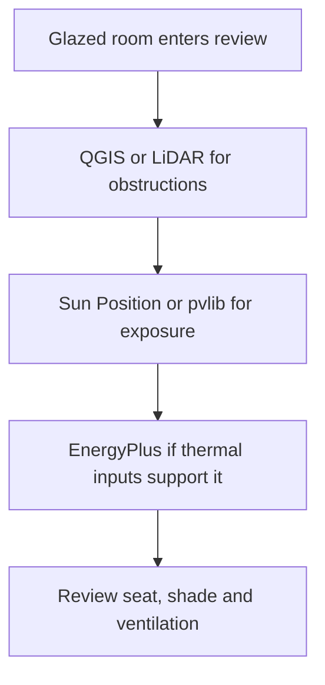

Register north against the actual building. Trace sun at the intended viewpoint against dated tree, roof and terrain heights. Compare glare, summer heat and winter cold under the relevant use and controls.

Record the four current findings, seasonal use, furniture and shade choice with their evidence and survey owner. [Glazed rooms](../skills/renovation-pack/references/glazed-rooms.md)

[Back to study list](#choose-a-study)

## Sun and shade

“Where can we sit in the evening sun?” A roof, hedge, window or neighbouring obstruction changes.

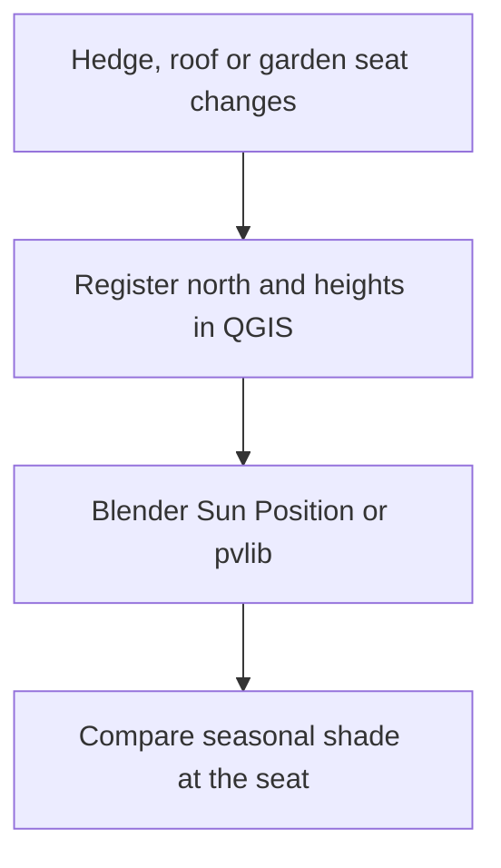

Establish true north, time, site levels and obstruction heights. Use QGIS or dated LiDAR for terrain, then Blender Sun Position or pvlib for seasonal comparisons.

Return the shadow or sightline to the seat, window or garden option. Survey any height that could reverse it.

[Back to study list](#choose-a-study)

## Thermal comfort

“Will these doors make the room too hot?” Insulation, glazing, shading, moisture or ventilation changes.

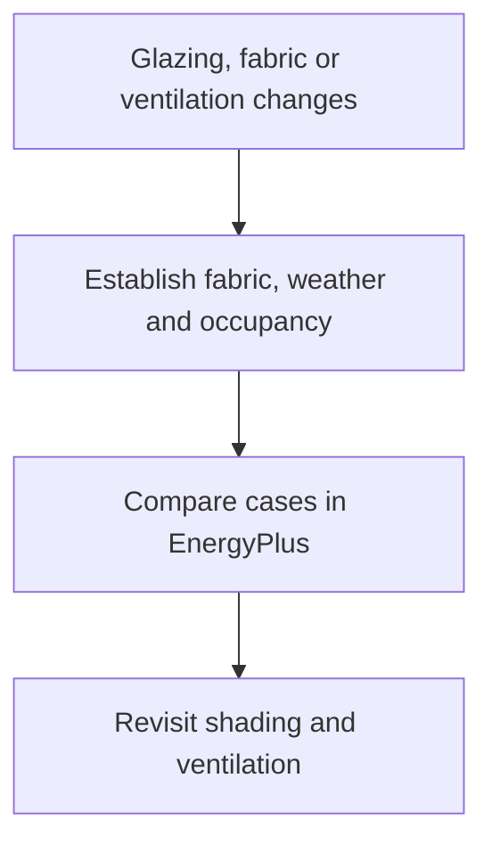

Review the section, fabric condition, airflow and use. Compare indoor conditions with EnergyPlus if weather, fabric and operating inputs support it. Seek a survey or building-services design where needed.

Revisit glazing, shading, ventilation, build-up or heating decisions and the occupied dimensions.

[Back to study list](#choose-a-study)

## Solar panels

“Is there room for solar panels?” A rooflight competes for a sunny roof face.

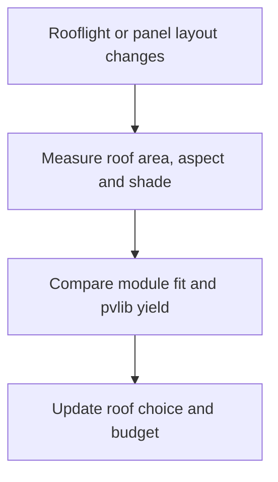

Check roof pitch, aspect, usable area and shading. Compare module fit, then pvlib generation. For savings add household demand timing, tariffs and an installed price.

Return the roof layout, yield range and assumptions to the roof decision and budget.

[Back to study list](#choose-a-study)

## House walkthrough

“Take me through the house and show me the view when I sit down.”

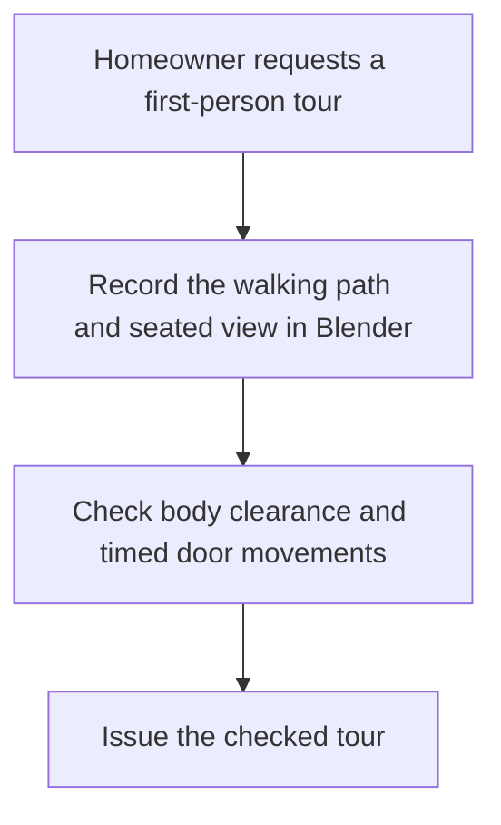

Use the [Blender house walkthrough](../skills/blender-house-walkthrough/SKILL.md) only when someone requests a first-person visit, in ordinary language or by skill name.

Give the homeowner the requested playable tour or navigable scene. Routine room checks and brochure tours keep their existing outputs.

[Back to study list](#choose-a-study)

## Access

“Can Dad get to the shower?” A chair pulls back, a buggy turns or a doorway changes.

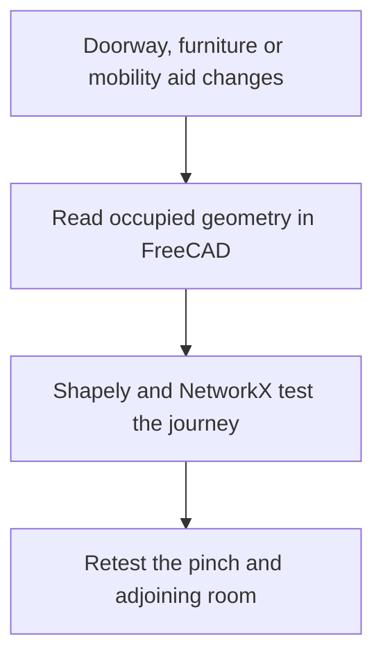

FreeCAD tests the person or aid, operating envelopes and connected thresholds. Shapely and NetworkX compare the whole occupied journey.

Record the pinch or deciding site measurement. Retest the adjoining room and each affected activity.

[Back to study list](#choose-a-study)

## Sightlines

“Can everyone see the TV?” A chair turns, an opening frames a neighbour or a garden seat loses privacy.

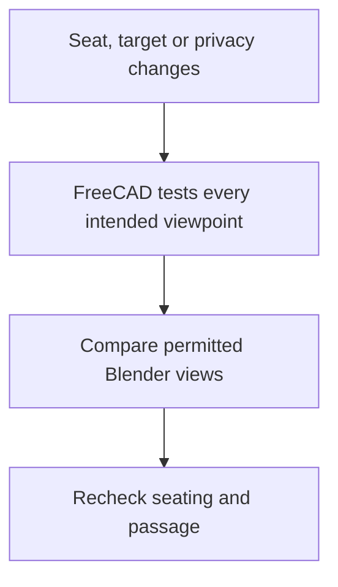

FreeCAD checks all intended viewpoints, target, natural fronts and moving people. An authorised Blender viewport compares the same eye position across options.

Return placements to CAD. Review sightline, conversation, reach and passage together.

[Back to study list](#choose-a-study)

## Acoustics

“Will music disturb a call upstairs?” A partition, door, noisy appliance or extract route changes.

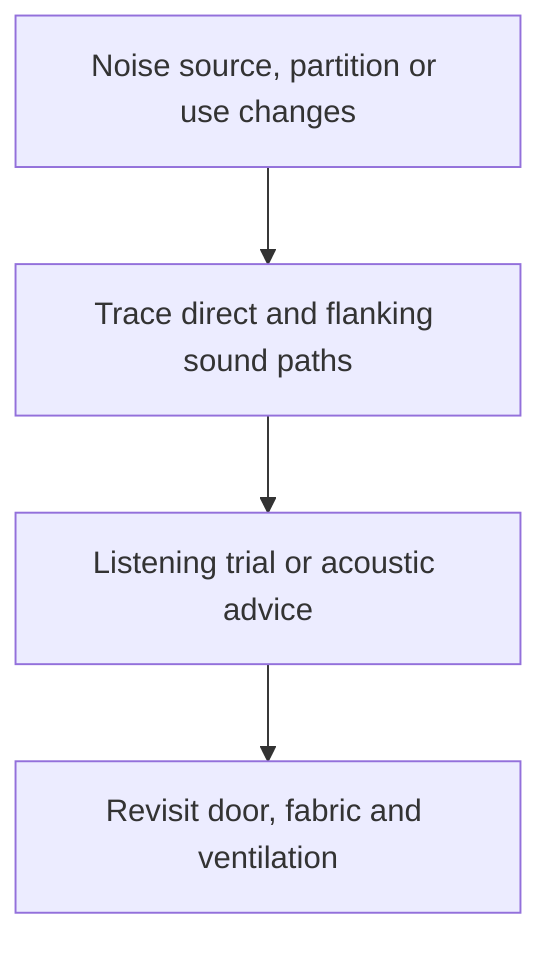

Trace likely sound and flanking paths, compare simultaneous uses and arrange a listening trial or acoustic advice if it changes the choice.

Return the finding to room use, door or fabric detail and any affected ventilation.

[Back to study list](#choose-a-study)

## Colour

“Make the room feel warmer.” A paint, upholstery, reused piece or lighting condition changes.

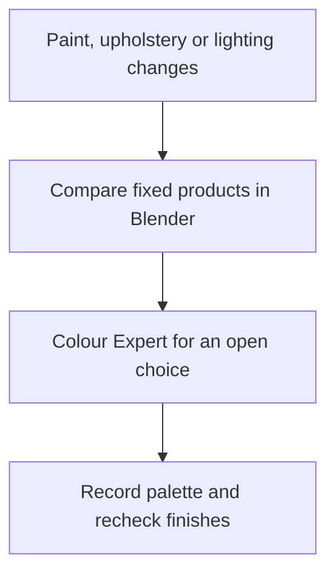

Blender compares the fixed products in the same camera and in neutral light. Use color-expert for open choices or casts. Use an early styling image only within scope.

Record the palette decision. Recheck the furnished camera, the final photo and any affected physical finish.

[Back to study list](#choose-a-study)

## Furnishing

“Show me how it will look.” A camera, product substitution, shopping variant or quantity changes.

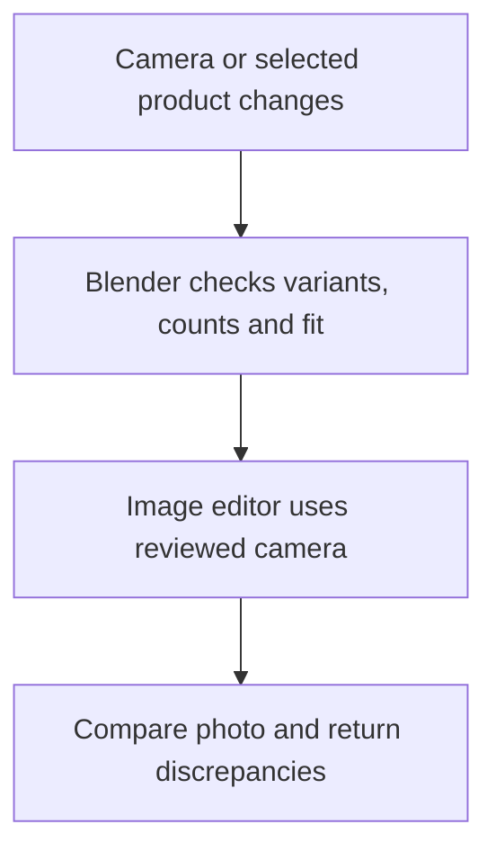

Blender interiors dresses and counts the selected items, checks clearances, assets and camera transfer. For final photography, edit the reviewed camera with the product references and inspect the result beside it.

Return fit errors to CAD, scene errors to Blender and image-only drift to the image editor.

[Back to study list](#choose-a-study)

## Finishes

“Which paint do I tell the decorator to buy?” A sample, sheen or finish instruction changes.

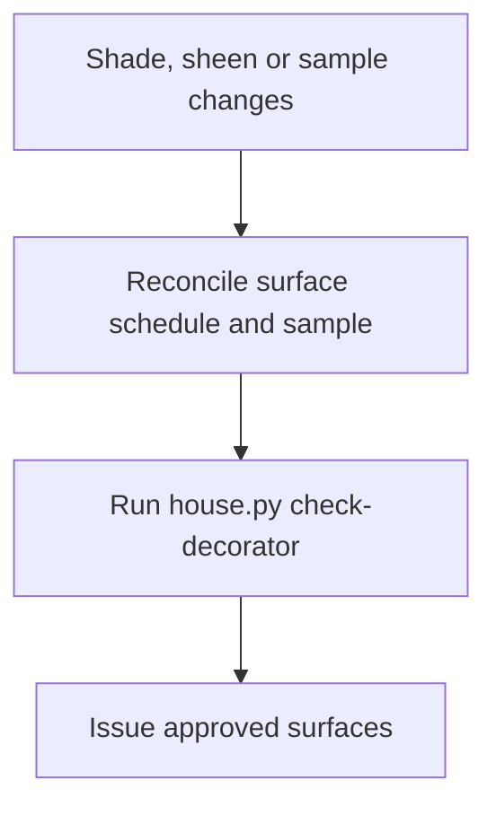

Review each scheduled surface, manufacturer, shade, sheen and recorded approval. Inspect physical samples where required and run check-decorator for the requested scope.

Issue approved surfaces and keep outstanding choices visible to the homeowner.

[Back to study list](#choose-a-study)

## Valuation

“What will it be worth after alteration?”

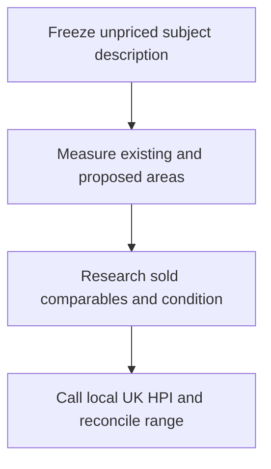

[Valuation study](../skills/renovation-pack/references/valuation.md) records the unpriced house specification, measured or provisional area, recent sales, listing condition and local UK HPI.

Return the reconciled range and evidence gaps to the feasibility pack.

[Back to study list](#choose-a-study)

## Tenders

“Does this quote cover the same job?” A supplier substitutes a unit or a builder excludes an item.

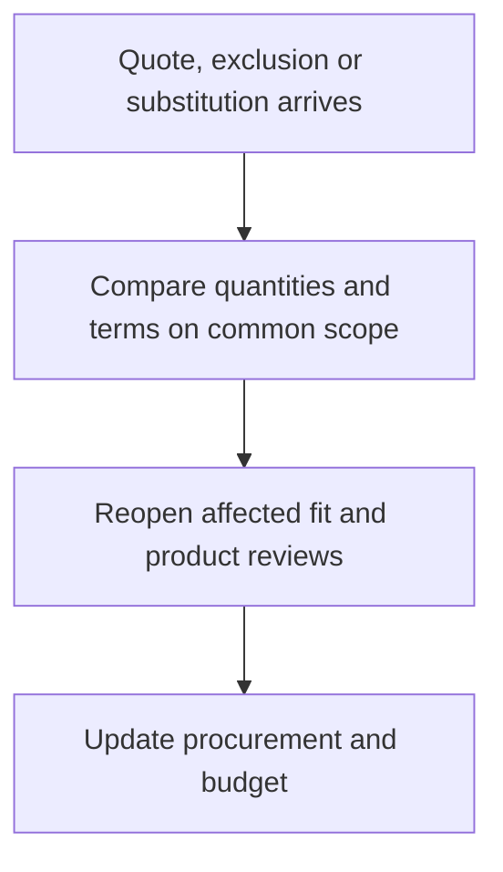

Reconcile quantities, dimensions, installation, exclusions, VAT, lead times and reserve on a common drawing and scope.

Update budget and procurement. A substitution reopens affected fit, product and camera reviews.

[Back to study list](#choose-a-study)

## Occupation

“Can we stay here while it is built?” A shared isolation, delivery or delayed trade changes the sequence.

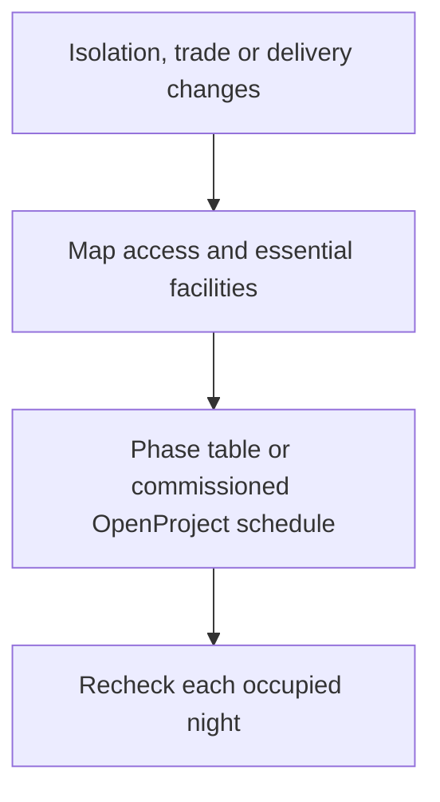

Renovation-pack maps essential facilities, occupied access and service handovers night by night. Use a phase table or OpenProject when a programme is commissioned.

Update the programme and temporary living costs. Hold a dependent strip-out until the facility works.

[Back to study list](#choose-a-study)

## Survey returns

“What should we check before buying?” A survey, new instruction or as-built return contradicts the issue.

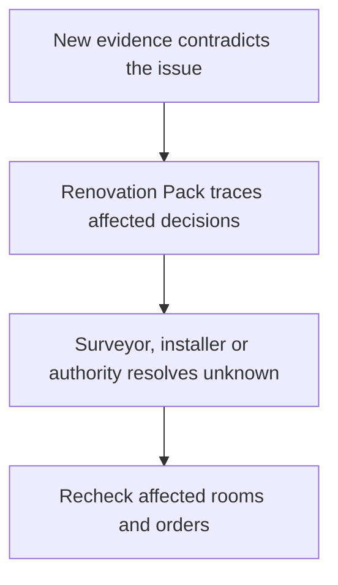

Renovation-pack identifies the uncertainty that could change the decision and routes it to the relevant surveyor, designer, installer or authority. At completion, reconcile commissioned tests, snags and warranties.

Issue a prioritised enquiry or reopen affected rooms, orders and records. Report what is still usable.

[Back to study list](#choose-a-study)
