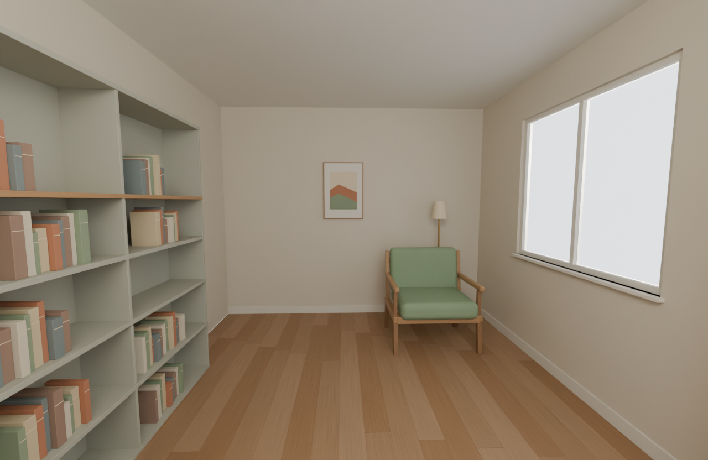
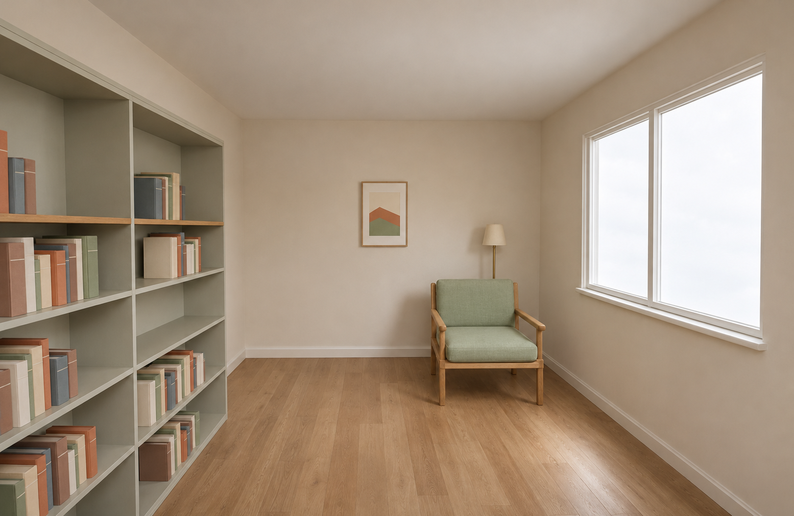

# Alder Cottage library

The fictional owner wants to reach the bookcase while someone reads beside the south window. The accepted layout retains one oak chair in sage linen and provides two 875 mm oiled oak shelves. The installer still needs to confirm shelf fixings and the socket location. [Decision and editable dimensions](library.json)

## Open or share the handover

Download the [furnished Alder Cottage house pack](reference/Alder-Cottage-furnished-handover.zip), extract it and open `Start here.html`. This fictional commission covers the library. The house edition contains the reviewed room and drawing, shopping schedule, homeowner presentation, architect pack, buyer brief, decorator finishes, editable costs and programme.

### Download just one pack

[Download any of the nine standalone ZIPs in your browser](https://getsimba-ai.github.io/room-by-room/library.html#downloads).

To share just one component, run the selector from the repository root with Python. It uses the recipient files in the house archive and the original standalone issue's index and link register. This works offline with the Python standard library.

```sh
python examples/furnished-room/select_component.py room-review "Alder library.zip"
python examples/furnished-room/select_component.py decorator-finishes "Decorator instruction.zip"
python examples/furnished-room/select_component.py --help
```

After reissuing the worked house, a maintainer can run `python examples/furnished-room/capture_handover.py "/path/to/houses/alder-cottage" HOUSE-FURNISHED "../Alder recipient reference"`. This rechecks the saved house against its current sources and compares each recipient file with its independently issued component. The new folder contains the recipient archive and its selector catalogue.

## Replay the layout check

Open the FreeCAD Python console and run the following, substituting the location of your clone and a new output folder. The script creates a separate document, saves an editable model, reopens it, and measures the door movement against the chair, bookcase and lamp.

```python
from pathlib import Path
import runpy

example = Path("/path/to/house-renovations/examples/furnished-room")
build = runpy.run_path(str(example / "build_cad.py"))["build"]
print(build(Path.home() / "Alder library replay"))
```

Open `Alder library.FCStd` to inspect the model. Turn on **Conservative hall door swing** in the model tree to see the tested area. `Layout checks.json` records the distances measured after reopening the model.

| Check | Reference result |
| --- | ---: |
| Full door swing to retained chair | 1,769.619 mm |
| Full door swing to bookcase | 1,594.936 mm |
| Full door swing to lamp | 2,564.949 mm |
| Open leaf to head | 6 mm |
| Selected shelf lengths | 875 mm each, two shelves |

The chair, bookcase and lamp use bounding shapes for this clearance study. To try a change, edit a copy of `library.json` beside the script and build into a second folder. Reducing the distance to zero holds the check.

## Build the furnished camera



The image above comes directly from the editable Blender scene. The camera faces east from the hall side. The west door is behind it. A second camera named **West door and head** shows the opening. All geometry, artwork, book covers and materials are created by the example script. The window looks out onto the lighting environment.

Use the repository's development dependencies, FreeCAD and Blender. The reference run used Blender 5.3. Start from the repository root. Substitute your own scratch path for `../Alder library demo` throughout.

1. Run `python examples/furnished-room/replay.py begin "../Alder library demo"`. This creates a fictional house with the baseline component example and opens its new CAD revision. In the FreeCAD console, run the layout builder shown above with the **printed output directory**.
2. Run `python examples/furnished-room/replay.py inspect-layout "../Alder library demo"` and open the printed PDF. Check the seated reader, the second reader at the bookcase and the route from the parked hall door. The reference 550 mm route has 546.1 mm to spare beside the occupied chair. These are design assumptions for the fictional household.
3. After inspecting the sheet, run `python examples/furnished-room/replay.py accept-layout "../Alder library demo" --reviewer "Your name"`. This saves the reviewed CAD revision, checks the layout and prints the new furnished revision directory.
4. In a **new Blender session**, run the following in its Python console. The builder creates a fresh scene, saves the editable model and reads the evaluated meshes back from disk.

```python
from pathlib import Path
import runpy

example = Path("/path/to/house-renovations/examples/furnished-room")
out = Path("/printed/furnished/revision/outputs")
runpy.run_path(str(example / "blender_console.py"))["prepare"](out)
```

5. Run `python examples/furnished-room/replay.py check-camera "../Alder library demo"`. It checks the reopened scene against the saved CAD bounds and the selected shopping items. An altered model requires fresh measurements. Once the command reports that Blender may proceed, render the active **View from the hall** camera in Blender.

```python
import bpy

bpy.context.scene.render.filepath = str(out / "Library camera.png")
bpy.ops.render.render(write_still=True)
```

The native file contains a single L01 chair and two L02 shelf boards, each 875 mm long. Both boards meet at the central upright, 1,375 mm above the floor. In the house schedule the installer still owns the fixing and socket checks before the shelves can be ordered.

## Compare the concept photograph



The photograph adds linen weave, book spines and oak grain. Compare the chair arms, the join between the two oak boards, the lamp and the window mullion with the camera above. The original west door is behind the camera in both images. The [comparison record](reference/review.json) identifies the two exact files, their source, reviewer and limits. Rebuilding the room can produce different pixels across Blender versions. Review any new camera and derivative together before issue.

## Earlier CAD-only handover

The same room dimensions and selections appear in the [standalone room, drawing and shopping editions](../component-pack/README.md). The [complete worked house ZIP](../trade-schedules/reference/Alder-Cottage-trade-handover.zip) also includes the homeowner presentation, architect pack, buyer brief, decorator finishes, editable costs and programme. Extract it and open `Start here.html`.

The earlier room issue uses a CAD-only review. The furnished edition above adds the source camera and concept photograph to the room review and homeowner presentation.

## Rebuild the public demo

With Python and Poppler (including `pdftoppm`) installed, run `python examples/furnished-room/build_site.py ../alder-site` from the repository root. Use a new output directory. The builder reads the published Alder reference, verifies the nine standalone ZIPs and renders the issued drawing. GitHub Pages serves the generated directory from the root of the `gh-pages` branch. After changing the example, rebuild and publish that directory as the branch contents.

### Deploy to Cloudflare Pages

From an authenticated Wrangler installation, run `python examples/furnished-room/deploy_cloudflare.py`. The command builds in a new directory and publishes to the production branch of the existing `roombyroom` project. It includes the reviewed walkthrough, English captions and the MP4 byte-range handler alongside all Alder Cottage downloads. Use `--wrangler` to specify a local CLI.
