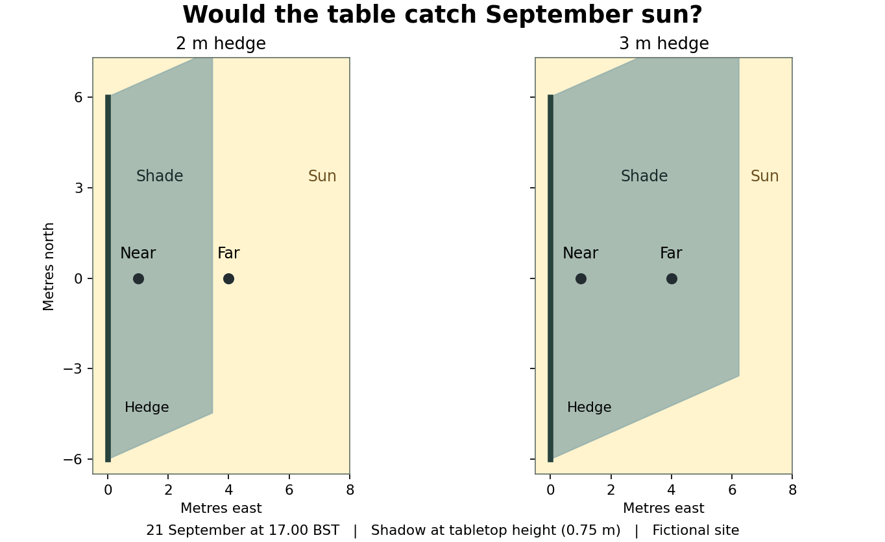

# Where would we still catch the sun for tea?

A fictional household wants direct sun at its outdoor table at 17.00 in June and September. Both locations have the same usable route to the kitchen. The household will move the table and wants to keep the west hedge. Its height is somewhere between 2 and 3 m.

## Replay the comparison

From the repository root run the following with standard Python.

```sh
python examples/garden-sun/replay.py
```

The ground is level. East is positive x and true north positive y. The opaque hedge runs along x = 0 from y = −6 to +6 m. The two tabletop centres are at (1, 0) and (4, 0) m, both 0.75 m above ground. The calculation traces a ray **towards** the sun and tests whether it hits the hedge. The fictional site is at 52° N, 1.5° W. The saved solar positions use local clock times, including British Summer Time. [Input angles](samples.csv) · [Calculation](replay.py)

| At the tabletop | Near, 2 m hedge | Far, 2 m hedge | Far, 3 m hedge |
| --- | --- | --- | --- |
| 21 June at 13.00 | Sun | Sun | Sun |
| 21 June at 17.00 | Shade | Sun | Sun |
| 21 June at 19.00 | Shade | Sun | Shade |
| 21 September at 17.00 | Shade | Sun | Shade |
| 21 December at 17.00 | Below horizon | Below horizon | Below horizon |



**Decision.** Try the far spot for June tea. Before fixing paving there for September use, measure the hedge along the line from the table to the September sun. At 17.00 that ray crosses the hedge at about 2.20 m above ground. A 2 m hedge clears it and a 3 m hedge blocks it. If September is the priority and it is taller, try another permitted spot before buying paving.

**Independent check.** A 2 m screen due west, a 45° western sun and a table 0.75 m high put the shadow edge 1.25 m east of the screen. The 1 m point falls inside and the 4 m point outside. Reversing the sun to due east should clear both points. At midday in the June example the ray misses the hedge.

The samples were calculated with pvlib 0.16.1 at sea level with its default solar-position method. To regenerate them in an environment with pvlib and pandas, parse the CSV times with `pandas.to_datetime(times, utc=True)` and call `pvlib.solarposition.get_solarposition(index, 52, -1.5, altitude=0)`. Use its `azimuth` and `apparent_elevation` columns. [pvlib solar position](https://pvlib-python.readthedocs.io/en/stable/reference/generated/pvlib.solarposition.get_solarposition.html)

**At a real house.** Register true north, levels, neighbouring roofs, trees and seasonal foliage. Identify whether the household wants sun on a face, table or planting bed. Test that area across the hours they use it, with an existing and a proposed model on the same setting. A site photo at a known time gives a check on the shadow direction. This exercise predicts geometric exposure at five instants under clear skies. Sunshine hours, indoor overheating and a formal neighbour daylight assessment each need different evidence.
