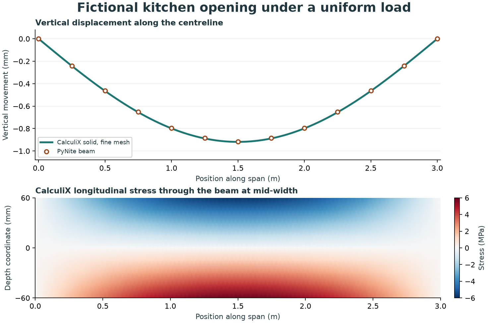

# A fictional kitchen opening through two solvers

**Question.** Can a future agent reproduce the same beam response with PyNite and FreeCAD FEM, and read the result back from the saved CAD? This is a software and handover exercise with assumed inputs. For a building alteration, follow the [structural opening review](../../skills/renovation-pack/references/specialist-design-tools.md#structural-openings).



| Recorded result | Hand calculation | PyNite | CalculiX fine solid mesh |
| --- | ---: | ---: | ---: |
| Upward reaction at each end | 1,500 N | 1,500 N | 1,500 N |
| Downward movement at midspan | 0.91553 mm | 0.91553 mm | 0.91868 mm |
| Outer-fibre longitudinal stress magnitude at midspan | 5.85938 MPa | 5.85938 MPa from the bending moment | 5.86044 MPa at the top and bottom centre nodes |

The original 25 November 2026 run used PyNiteFEA 3.2.1, FreeCAD 1.1.4 and CalculiX 2.22. The fine mesh has 3,072 elements and 4,365 nodes. The 384-element coarse mesh gave 0.91799 mm, a change of 0.075% on refinement. [Recorded results](reference/results.json) · [Original FreeCAD file](<reference/Scratch opening.FCStd>) · [Values read from that file](reference/freecad-readback.json)

## Replay

Start FreeCAD with FEM, its CalculiX solver and the live FreeCAD MCP add-on running. Use the same computer or a directory mounted at the same path for the agent and FreeCAD. With Python 3.11 and the MCP server available, run this from the repo root. The example installs its Python dependencies on demand with `uv`.

```sh
uv run --no-project --python 3.11 --with-requirements examples/structural-opening/requirements.txt python examples/structural-opening/replay.py --output ../renovation-scratch/opening-run-01
```

Alternatively install `examples/structural-opening/requirements.txt` in a dedicated Python environment and run the same `replay.py` command with that interpreter. Supply `--mcp-command "/path/to/freecad-mcp"` if the server is outside PATH and the usual per-user bin folder. The runner uses the configured FreeCAD FEM solver, the bundled binary or `ccx` on PATH. [Connector setup](../../README.md#verify-the-design-tools-on-a-new-computer)

Each run needs a new output directory. The runner prints **PASS** after the numerical and native-file checks. A missing connector, failed solve, mismatched read-back or result outside tolerance stops the run. Inspect the failing stage and its solver log, then retry in a new directory. The saved reference stays available for comparison.

## What the agent runs and checks

Two clean replays of this example reproduced the original input decks after normalising line endings and matched the complete saved numerical summary. In a separate failure check, changing the reopened midspan reading by 0.1 mm caused verification to fail. Attempting to reuse a run directory also stopped before any output was written.

| Stage | Input and action | Evidence |
| --- | --- | --- |
| 1. Prepare locally | Read the fictional [case](case.json). Solve one beam member in PyNite and generate coarse and fine solid-mesh input decks for the same load and span. | `pynite-results.json` and both `calculix/*/opening.inp` files. [Preparation code](prepare.py) |
| 2. Solve through live FreeCAD MCP | Create a scratch analysis document. Run both decks with FreeCAD FEM, retain the logs and import the fine-mesh field. | Reactions in `.dat`, nodal displacements and stresses in `.frd`, plus `Scratch opening.FCStd`. [FEM code](freecad_case.py) |
| 3. Reopen through MCP | Close only the new scratch document. Open its saved file, count mesh nodes and solids and sample vertical displacement and longitudinal stress at the three midspan points. | `freecad-readback.json` with native versions, counts and values. |
| 4. Verify locally | Compare the solvers with the independent hand solution, compare the two meshes and match the reopened file to the raw fine-mesh results. Compare the numerical outputs with the original run. | `verified-results.json`, `solver-comparison.png` and the final pass or failure. [Numerical checks](compare.py) · [Replay and reference comparison](replay.py) |

## Assumptions and tolerances

The simply supported rectangular member is 3,000 mm long, 80 mm wide and 120 mm deep. Its elastic modulus is 100,000 N/mm² and Poisson's ratio is 0.30. A uniform load of 1 N/mm acts downwards, totalling 3 kN. The solid model applies the equivalent 0.0125 N/mm² pressure to the top face. There is no self-weight or load factor. The left support restrains longitudinal movement and the right permits it. The decks define the lateral restraints that keep the sample steady. All values are fictional.

For span L and line load q, each reaction is qL/2, the maximum moment is qL²/8 and midspan deflection is 5qL⁴/(384EI). PyNite gives 1.125 kN·m. The solid check allows 0.1 N per reaction, 2% against the hand deflection and fine-mesh outer-fibre stresses, and 0.5% between mesh deflections. The saved reference comparison uses 0.01% relative tolerance with a 0.0000001 absolute floor. Reopened field values must match the raw results within 0.00001 in their stated units, with matching integer mesh counts. This case checks the response at midspan. An engineer would need the real load path, materials and bearings to assess a house.
