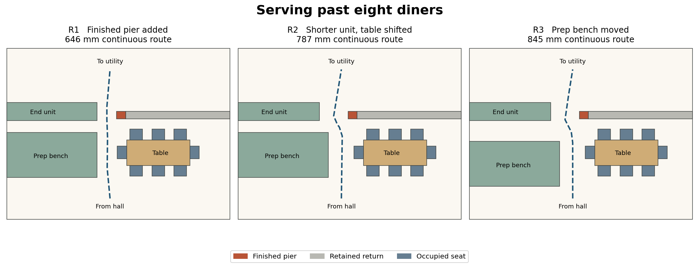

# One pier, two tenders and twelve nights at home

The fictional owners of **Orchard House** want to serve four on weekdays and eight at weekends, stay at home through a two-bathroom refit and keep their **£210,000 ceiling**, including a protected £10,000 reserve. They will move dry furniture, shorten the kitchen storage run and use an existing utility shelf. They want the sink and hob to stay put. Both bathrooms contain a WC and shower. The family sleeps upstairs and reaches the downstairs shower via the hall.

## How the house plan changes

| Decision | Before | Revised whole-house plan | What releases the next step |
| --- | --- | --- | --- |
| The engineer returns the finished pier position | The kitchen schedule and dining layout assume a clear return. The four-person test passes. Eight already poses a problem. | Shorten the end unit by 300 mm, store its displaced contents in the utility, shift the table 180 mm east and move the dry prep bench 300 mm south. Issue the same R3 plan to both bidders. | The owner accepts the storage swap. Survey the site against the issued pier position before ordering fitted units or templating. |
| The second builder includes two items excluded by the first | A looks £4,000 cheaper on the face of the quotes. The bathrooms, appliances and reserve sit elsewhere in the house budget. | B becomes £1,400 cheaper on comparable scope. Its whole-house comparison is £208,000. Only £2,000 is available for the occupied works arrangement. | Confirm inclusions, quote validity, programme and payment terms in writing. Compare the cost of staying in the house before appointing. |
| Both bathrooms rely on a shared water supply | The original sequence leaves four nights without a working WC and shower. Staggering the rooms still loses two nights. | Set aside the garage for deliveries, keep the hall usable, restore water each evening and hold the second strip-out until the first room works. With B the house total becomes £209,600. | Plumber and site lead demonstrate actual service and access to the family. If handover slips, delay the next strip-out and rebook dependent trades. |

## 1. Where the pier changes the kitchen

The engineer's fictional return fixes the finished face 300 mm further west than the old return. The owner wants an 825 mm continuous serving route on the kitchen side of the table and 800 mm at the far side for access when hosting. Both are household targets. The model uses four side seats daily and six side seats plus two end seats for hosting. It tests the hall-side approach to the utility-side approach with diners seated.



| CAD state | Beside pier | Continuous route with four | With eight | Decision |
| --- | ---: | ---: | ---: | --- |
| R0, original return | 950 mm | 945 mm | 666 mm | Daily use works. The west end chair already restricts hosting. |
| R1, finished pier inserted | 650 mm | 646 mm | 646 mm | Withdraw the original cabinet set-out from pricing. |
| R1a, shorten the end unit | 950 mm | 787 mm | 666 mm | A tape measure beside the pier suggests success. The diagonal turn and end chair still obstruct the route. |
| R2, also shift the table east | 950 mm | 787 mm | 787 mm | The occupied west and east side gaps are now 850 and 840 mm. The corner of the prep bench still controls the walking route. |
| R3, also move the dry bench south | 950 mm | 945 mm | 845 mm | Both serving cases meet the brief. The east side retains 840 mm with eight diners and the south arrival strip measures 1,100 mm. Carry R3 into the two tenders. |

**Independent check.** At R2 the bench corner and pier corner are 650 mm apart across the room and 450 mm apart along it. Their diagonal separation is about 791 mm. Moving the bench south increases that second dimension to 750 mm. The hosting constraint then shifts to the 850 mm gap beside the west end chair. The route code conservatively allows for rounding around corners, giving 845 mm along the continuous path.

**Evidence.** Live FreeCAD MCP created, saved and reopened the fictional editable boxes. The export reads actual solid bounds in millimetres for the kitchen, return, pier, table and each occupied position. The local Shapely and NetworkX replay uses those bounds. This is a plan study of the marked route and furniture, scoped to the rear rooms. The fixture supplies a finished footprint for coordination. A live house needs the engineer's design, including headroom and support below, and the adjoining thresholds checked on its own survey. [Editable FreeCAD example](<reference/Example rear rooms.FCStd>) · [Reopened bounds](reference/rear-rooms.json)

## 2. Which builder fits the house budget?

The fictional comparison takes place on **25 November 2026**. The enquiry sent both builders **R3** with the finished pier, changed end unit, bench move and displaced storage shelf. Both exclude owner-supplied appliances. All figures include VAT.

| Written offer | What the builder actually offers | What the owner adds for comparison |
| --- | --- | --- |
| A, dated 23 November, valid through 7 December | £48,000 for the rear works. Electrical work and making good to existing finishes are excluded. | Client allowances of £3,600 and £1,800. Ask A to replace these with written prices. |
| B, dated 24 November, valid through 11 December | £52,000 for the same rear works including electrics and making good to the agreed finish. | Zero adjustment on these two lines. Confirm the finish boundary and that the price still covers the occupied programme. |

| GBP including VAT | Builder A | Builder B |
| --- | ---: | ---: |
| Written rear-works offer | 48,000 | 52,000 |
| Electrical work outside offer | 3,600 allowance | Included |
| Making good outside offer | 1,800 allowance | Included |
| **Comparable rear package** | **53,400** | **52,000** |
| Other house packages, including the bathroom refits | 142,000 | 142,000 |
| Owner-supplied appliances | 4,000 | 4,000 |
| Protected reserve | 10,000 | 10,000 |
| **House total before occupied working** | **209,400** | **208,000** |
| Extra cost for occupied working | 1,600 | 1,600 |
| **Revised house total** | **211,000** | **209,600** |
| **Headroom against £210,000** | **£1,000 over** | **£400 available** |

**Decision.** Take B forward for clarification and keep the appliance purchase on its own budget line. Ask A for a fixed electrical and making-good price. Its two extras together must fall below £4,000 to beat B's £52,000, and must be at most £4,400 to meet the occupied house ceiling. The occupied working sum covers extra sequencing of the same bathroom works. Charging the bathroom refits again would double-count them. If B excludes an additional £600 on clarification, the occupied total reaches £210,200. Reopen scope or funding with the owner before appointment. [Quote inputs](quotes.csv) · [House allowances](house-budget.json)

## 3. Which bathroom works tonight?

The owner accepts agreed daytime interruptions, needs both a reachable working WC and shower every night, and wants secure entry. The programme counts the end-of-day condition. The occupied working allowance is £1,600 including VAT in this example, made up of £1,000 for phased plumbing visits and testing, £400 for protected access and £200 for delivery handling. The £142,000 elsewhere already includes the bathroom works themselves.

| Plan tested | Nights without an accessible working bathroom | What the site lead changes |
| --- | --- | --- |
| Strip both rooms together | 1, 2, 3, 4 | Start upstairs and retain the downstairs room while it is needed. |
| Stagger rooms, keep deliveries and water isolation as booked | 2, 3 | On night 2, boxed cabinets block the hall to the only bathroom. On night 3 the shared water supply is isolated. Store the delivery in the garage, keep the hall clear and coordinate nightly reinstatement with the plumber. |
| Occupied programme | None of 12 | Nights 1 to 4 use downstairs. Night 5 both rooms work. Nights 6 to 9 use upstairs. From night 10 both work. Keep the garage fit-out behind the delivery move and provide an agreed daytime WC arrangement during isolations. |
| Upstairs first works on night 7, downstairs still stripped as booked | 6 | A booked strip-out removes the last working room. |
| Same late handover, downstairs strip-out follows actual availability | None of 12 | Keep downstairs working through night 7. It is offline on nights 8 to 11. Move the downstairs trades and final decoration two nights later. Obtain any remobilisation cost. |

**The handover that matters.** Before taking the second bathroom out, the plumber demonstrates hot and cold supply, a flushing WC, a usable shower and working waste. The site lead checks lighting, privacy and an unobstructed route from the bedrooms. The owner confirms they can use it that evening. If the supply cannot be restored or a safe route fails, pause the dependent strip-out and price temporary facilities or accommodation. A £600 extra exceeds the remaining £400. That returns a programme change to the house budget. [Night-by-night inputs](programme.json)

## Replay or adapt

From the repository root, use Python with the [route dependencies](../../requirements-routes.txt).

```sh
python -m pip install -r requirements-routes.txt
python examples/whole-house-changes/replay.py
```

The command reads the saved native measurements, quotes and programme. To remake the illustration, use Matplotlib and run `python examples/whole-house-changes/draw_plan.py plan.png`. To regenerate the geometry, use the [FreeCAD skill](../../skills/freecad-renovation/SKILL.md) and send [pier_cad.py](pier_cad.py) through live MCP followed by `print(build_example("/absolute/path/to/new/folder"))`. Inspect the saved model, switch on one revision and one dining group, and compare the exported bounds with the reference before replacing it. [Calculation and programme logic](replay.py)

To run a single case, append `pier`, `quotes` or `bathrooms` to the replay command. Quotes and bathrooms use only the Python standard library.

## Recover the pier revisions

Run the following from a Git checkout with the route dependencies installed. Supply a fresh directory outside the checkout. The exercise creates a fictional house, works through the normal house commands, backs it up and restores it into a second library.

```sh
python examples/whole-house-changes/revision_replay.py --output "../renovation-scratch/pier-recovery-01"
```

Open `fresh-checkout/houses/orchard-house/revisions/PIER-R3/record.json` under the output directory to read the reason, parent revision, affected trades and next decision. Both saved revisions contain `outputs/serving-route.json`. The R1 file records 646 mm for eight diners and R3 records 845 mm. Each captures the original editable fixture, which contains both CAD options, and the native measurements used to calculate its route.

The drill checks the repository's Git ignore rules, confirms the fresh clone contains no house records, restores the decision history and all files byte for byte, and repeats the restore to check it adds zero files. To inspect the recovered geometry, open `revisions/PIER-R3/inputs/models/Example rear rooms.FCStd` in the recovered house. In FreeCAD the straight gap from the cabinet end to the pier is 650 mm in R1 and 950 mm in R3. The occupied route includes the turn past the diners. [Recovery script](revision_replay.py) · [House revision commands](../../docs/output-revisions.md)
