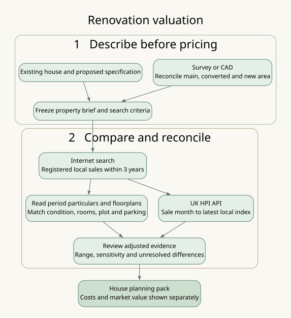
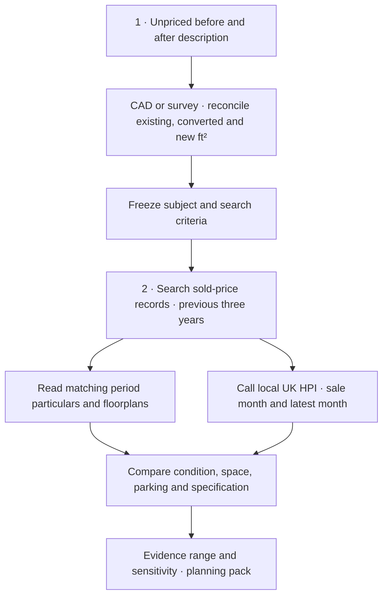

# Valuing a proposed renovation

Run this specialist review when the homeowner asks about present value, finished value or the financial effect of extra space. Keep the assessment with the house revision. For UK properties choose the appropriate national sold-price register and local UK HPI series. Never substitute asking prices for completed transactions.

1. Write and date an unpriced subject brief. Describe the existing and finished house, type, tenure, independent bedrooms, layout, condition, quality, services, parking, plot, works and remaining approvals. Tabulate survey/CAD areas before and after using the same boundary and units. Separate habitable space, conversions, conservatories and genuinely new floor area. Set geographic, type, size, condition and trailing three-year sale criteria. Freeze the brief with SHA-256.
2. Search registered sales, match numbered addresses to dated marketing particulars and floorplans, and record floor-area basis. Read listing text for observable features and specification. Separate agent opinion, renovation potential and superlatives from facts. Resolve contradictions with plans or lower the weight. Exclude asking prices, unrelated listings and post-sale changes. Retain rejected comparisons with reasons. Use the regional property-type index for the transaction month and latest observed month at the valuation date. Record source release dates on historic replays. Compare whole prices and like-for-like unit rates, explain the range, sensitivity and what an independent valuer must verify. Costs belong in the feasibility comparison separately.

Run `python tools/valuation.py Property-brief.md Sales.json Adjusted-sales.csv`. The JSON fields are `as_of`, `brief_sha256`, `index_month`, `region`, `index_field` and `sales`. Each sale has address, ISO date, paid price in GBP, source URL, condition evidence and role. The tool checks dates and the frozen brief and calls the official monthly UK HPI endpoint. It writes indexed transactions; the reviewer reconciles condition, area and context and records any judgement separately.

